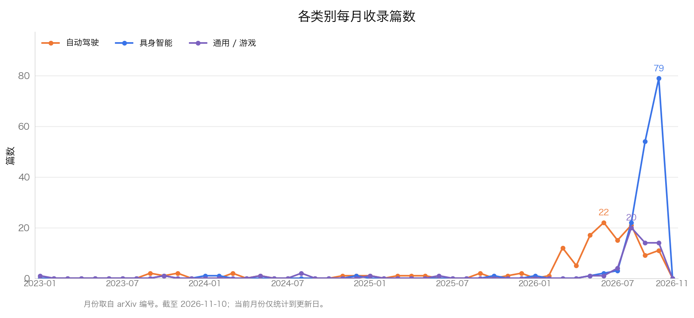

<!-- ============================================================ -->
<!-- 本文件由 scripts/generate_readme.py 从 data.yaml 自动生成，请勿手动编辑 -->
<!-- ============================================================ -->

# Awesome Interactive World Models

**简体中文** | [English](README.en.md)

> 面向自动驾驶与具身智能的可交互世界模型

世界模型 (World Model) 通过学习环境的动态表征，实现对未来的预测与想象； 可交互世界模型进一步支持以动作 (action) 为条件的生成与控制， 为自动驾驶和具身智能提供数据引擎、神经仿真器与策略学习基础。 本仓库收录并整理该方向的代表性工作，按应用场景分类， 并标注每篇工作的交互能力维度。

📊 共收录 **360** 篇工作 ｜ 最后更新：2026-11-10

  

  

## 交互能力图例

| 图标 | 含义 |
| :---: | :--- |
| 🎮 | 动作条件生成 |
| ⚡ | 实时推理 |
| 🔁 | 闭环支持 |
| ⏳ | 长时序一致性 |

## 目录

- [自动驾驶 Autonomous Driving](#自动驾驶-autonomous-driving)（132）
- [具身智能 Embodied AI](#具身智能-embodied-ai)（167）
- [通用 / 游戏 General / Game](#通用--游戏-general--game)（61）

## 自动驾驶 Autonomous Driving

| 论文 | 发表 | 机构 | 交互能力 | 链接 | 一句话点评 |
| :--- | :--- | :--- | :---: | :--- | :--- |
| **4D-WAM**: 4D Consistent World Modeling for Autonomous Driving | arXiv (2026) | Zhiwei Xiong 团队 | — | [论文](https://arxiv.org/abs/2608.10107) | 几何基础模型提供 4D 一致性监督，决策导向时间步采样强化规划。 |
| **A Risk-Field Enhanced Closed-Loop Digital Twin Framework for Autonomous Driving Safety Validation** | arXiv (2026) | Yongzhi Liu 团队 | 🔁 | [论文](https://arxiv.org/abs/2607.09772) | 风险场驱动的闭环数字孪生框架，统一障碍、车道偏离、碰撞时间等风险用于策略训练。 |
| **AD-E2E-JEPA**: A Joint-Embedding Predictive Architecture For End-to-End Autonomous Driving | arXiv (2026) | 纽约大学 / AMI | 🎮 | [论文](https://arxiv.org/abs/2609.34085) \| [代码](https://github.com/HaoranZhuExplorer/AD-E2E-JEPA) | 动作条件的 JEPA 不训练驾驶策略，用未来图像当目标，在轨迹词表里零样本选轨迹。可学习投影把规划用的 patch 减到 1/16、维度减到 1/4，推理约快 100 倍，8 帧展开、256 条候选大约 0.8 秒。平均 20 米外的目标，256 条候选时位移误差 4.0 米，8192 条时 2.8 米。NAVSIM v2 在 100 个场景上的零样本规划为 67.3/72.9 EPDMS（带安全乘积项）和 84.1/86.5 EPDMS†；自监督投影再用于模仿学习，EPDMS 从 80.2 到 85.4。 |
| **ADV-0**: Closed-Loop Min-Max Adversarial Training for Long-Tail Robustness in Autonomous Driving | arXiv (2026) | Jian Sun 团队 | 🔁 | [论文](https://arxiv.org/abs/2603.15221) | 零和马尔可夫博弈 + 迭代偏好学习逼近最优对手分布，attacker-defender 共演化。 |
| **AffordDrive3D**: Affordance-Aware World-Action Modeling with Spatial Understanding | arXiv (2026) | University of California, Los Angeles / NVIDIA / 42dot by Hyundai / University of Toronto | — | [论文](https://arxiv.org/abs/2610.11060) \| [项目](https://afforddrive3d.github.io/) | 共享 VLM 联合预测未来 RGB、深度、可行驶区与碰撞关键区以辅助轨迹学习；不加 RL 的 NAVSIM 消融中，PDMS 从仅动作的 88.1 升至 89.6。未来预测分支仅在训练期使用，未验证动作条件反事实预测或完整闭环驾驶。 |
| **AlignADV**: Learnability-Guided Adversarial Training for Safe Autonomous Driving | arXiv (2026) | Jian Sun 团队 | — | [论文](https://arxiv.org/abs/2606.14032) | 偏好对齐生成可解决场景 + 行为指纹能力预测，动态课程采样降低 40.6% 训练步。 |
| **AnchorDrive**: LLM Scenario Rollout with Anchor-Guided Diffusion Regeneration | arXiv (2026) | Chen Xiong 团队 | — | [论文](https://arxiv.org/abs/2603.02542) | LLM 闭环驾驶员智能体生成锚点 + 扩散再生成完整轨迹，兼顾可控与真实。 |
| **AnyScene**: Towards Highly Controllable Driving Scene Generation at Anywhere and Beyond | arXiv (2026) | Benjin Zhu 团队 | — | [论文](https://arxiv.org/abs/2605.26113) | 以占据为中心的统一框架，从 BEV 布局自回归生成占据序列与多视角驾驶视频。 |
| **BeyondSight**: Object Permanence for End-to-End Autonomous Driving | arXiv (2026) | Steven L. Waslander 团队 | — | [论文](https://arxiv.org/abs/2607.09138) | 解耦存在性与可观测性，时序传播 actor 查询实现遮挡下的感知预测规划。 |
| **BrainWAM**: Action-Space Coordination of Semantic Priors and Predictive Dynamics for Autonomous Driving | arXiv (2026) | Zhaoxiang Zhang 团队 | — | [论文](https://arxiv.org/abs/2608.12854) | 结构化动作空间协调语义推理与预测世界建模两条专门化通路，取得 NAVSIM SOTA。 |
| **CARS**: Learning Responsibility-Attributed Adversarial Scenarios for Testing Autonomous Vehicles | arXiv (2026) | Cheng Wang 团队 | — | [论文](https://arxiv.org/abs/2605.13751) | 上下文感知对手选择 + 生成对抗策略，碰撞场景可归责且法规对齐。 |
| **CCFM**: Collision-Constrained Flow Matching for Safety-Critical Scenario Generation | arXiv (2026) | Ruwen Qin 团队 | — | [论文](https://arxiv.org/abs/2607.04451) | 硬约束定义四类碰撞，流匹配 + 高斯-牛顿投影保证碰撞类型可控。 |
| **CLEAR**: Closed-Loop Reinforcement Learning at Scale for End-to-End Autonomous Driving | arXiv (2026) | Fatih Porikli 团队 | 🔁 | [论文](https://arxiv.org/abs/2607.02841) | 残差航点策略 + 异构仿真流水线，取得 Bench2Drive 与 CARLA longest6 SOTA。 |
| **CMU-Drive and V2V-VLA: Cooperative Multi-agent Unified Driving with Reasoning Benchmark** | arXiv (2026) | Stephen F. Smith 团队 | 🔁 | [论文](https://arxiv.org/abs/2608.07621) | 首个多车协同闭环端到端驾驶基准与 V2V-VLA 模型，联合生成动作、航点、推理与通信。 |
| **Cam2Sim**: Neural Scenario Reconstruction for Closed-Loop Autonomous Driving Simulation | arXiv (2026) | Andrea Stocco 团队 | 🔁 | [论文](https://arxiv.org/abs/2607.04770) | 把真实驾驶录像重建为可闭环执行的 CARLA 场景，结合高斯泼溅渲染缩小仿真视觉差距。 |
| **CausalDrive**: Real-time Causal World Models for Autonomous Driving | arXiv (2026) | Xiaomi | 🎮 ⚡ | [论文](https://arxiv.org/abs/2606.15341) | 仅用初始图像、自车轨迹和宏观社会学提示让模型自主生成周车反应的实时因果视频世界模型。 |
| **CoWorld-VLA**: Thinking in a Multi-Expert World Model for Autonomous Driving | arXiv (2026) | Gong Che 团队 | — | [论文](https://arxiv.org/abs/2605.10426) | 四类专家 token（交互/几何/演化/轨迹）+ 扩散层级融合规划器。 |
| **CommonRoad-Game**: A Human-in-the-Loop Simulation Framework for Autonomous Driving | arXiv (2026) | Youran Wang 团队 | 🔁 | [论文](https://arxiv.org/abs/2607.01382) | 轻量级人机闭环驾驶仿真框架，多线程同步支持交互式场景生成与规划测试。 |
| **Conditional Flow-VAE for Safety-Critical Traffic Scenario Generation** | arXiv (2026) | Raquel Urtasun 团队 | — | [论文](https://arxiv.org/abs/2605.04366) | 条件潜流匹配将名义场景分布匹配为安全关键 rollout。 |
| **DA-WAM: Decision-Aligned Future Latents for Driving World Models** | arXiv (2026) | HKUST Jun Ma 团队 | 🎮 | [论文](https://arxiv.org/abs/2608.19085) | 通过将轨迹与未来表征对齐，从而提高驾驶世界模型的性能。 |
| **DLWM**: Dual Latent World Models enable Holistic Gaussian-centric Pre-training in Autonomous Driving | arXiv (2026) | Shaojie Shen 团队 | — | [论文](https://arxiv.org/abs/2604.00969) | 双潜世界模型（占据流 + 规划流）实现高斯中心式自动驾驶预训练。 |
| **DecoupleGS**: Interactive 3D Gaussian Splatting for End-to-End Autonomous Driving Testing | arXiv (2026) | Haotian Shi 团队 | ⚡ 🔁 | [论文](https://arxiv.org/abs/2608.01761) | 解耦动静高斯泼溅，为端到端自动驾驶提供高保真实时闭环传感器仿真平台。 |
| **Dreamer-SAC**: Off-Policy Learning in Latent World Models for Sample-Efficient Autonomous Driving | arXiv (2026) | Xi Xiong 团队 | 🎮 | [论文](https://arxiv.org/abs/2608.10386) | 循环状态空间世界模型 + 离策略 SAC + n 步估计，提升自动驾驶样本效率。 |
| **DriveCache**: Action-Aware Caching for Driving World Model Inference | arXiv (2026) | Jianchun Yang 团队 | 🎮 | [论文](https://arxiv.org/abs/2608.16354) | 针对扩散驾驶世界模型的动作感知 KV 缓存策略，在多步去噪中复用空间不变特征，显著提升生成吞吐量。 |
| **DriveCombo**: Benchmarking Compositional Traffic Rule Reasoning in Autonomous Driving | arXiv (2026) | Kaicheng Yu 团队 | — | [论文](https://arxiv.org/abs/2603.01637) | 组合式交通规则推理基准，评估驾驶系统对复杂规则的理解能力。 |
| **DriveFix**: Spatio-Temporally Coherent Driving Scene Restoration | arXiv (2026) | Qi Guo 团队 | — | [论文](https://arxiv.org/abs/2603.16306) | 交错扩散 Transformer 建模时序依赖与跨相机一致性，实现 4D 驾驶场景修复。 |
| **DrivePTS**: A Progressive Learning Framework for Driving Scene Generation | arXiv (2026) | Cheng Lu 团队 | — | [论文](https://arxiv.org/abs/2602.22549) | 渐进学习解耦几何条件依赖，VLM 多视角描述 + 频率结构损失提升场景生成保真度。 |
| **DriveWAM**: Video Generative Priors Enable Scalable World-Action Modeling for Autonomous Driving | arXiv (2026) | Li Jiang 团队 | 🎮 | [论文](https://arxiv.org/abs/2605.28544) | 预训练视频扩散 Transformer 适配为自回归视频-动作策略，场景演化语义引导。 |
| **DriveWLA**: Unifying Future Dynamics and Scene Semantics through World-Language-Action Modeling for Autonomous Driving | arXiv (2026) | Huazhong University of Science and Technology / Yinwang Intelligent Technology Co. Ltd. | 🔁 | [论文](https://arxiv.org/abs/2610.17903) | 以世界、语言和动作三专家联合学习未来特征与轨迹；强化学习前的同协议消融中，加入世界专家使 NAVSIM v1 PDMS 从 86.2 升至 90.8，并有 HUGSIM 闭环评测。未来分支不读取候选动作，Bench2Drive 转移结果仅为日志开环指标。 |
| **DriveWeaver**: Point-Conditioned Video Inpainting for Controllable Vehicle Insertion in Autonomous Driving Simulation | arXiv (2026) | Li Zhang 团队 | — | [论文](https://arxiv.org/abs/2606.31918) | 点云条件视频修复实现可控车辆插入，并提取 3DGS 支持实时渲染。 |
| **DynamicVGGT**: Learning Dynamic Point Maps for 4D Scene Reconstruction in Autonomous Driving | arXiv (2026) | Xiangyang Xue 团队 | — | [论文](https://arxiv.org/abs/2603.08254) | 扩展 VGGT 至动态 4D，联合预测当前与未来点图并引入运动感知注意力。 |
| **Dynasto**: Validity-Aware Dynamic-Static Parameter Optimization for Autonomous Driving Testing | arXiv (2026) | Foutse Khomh 团队 | — | [论文](https://arxiv.org/abs/2603.21427) | RL 对手 + 时序逻辑有效性 + 遗传算法搜索初始条件，有效失败率提升 60-70%。 |
| **E2E-CDiff**: End-to-end Conditional Diffusion for Realistic and Controllable Visual Traffic Scenario Generation | arXiv (2026) | Philip S Yu 团队 | 🎮 | [论文](https://arxiv.org/abs/2607.18637) | 前视条件联合去噪运动状态与低层控制，支持碰撞规避/碰撞引导的交互场景生成。 |
| **ECoSim**: Data Efficient Fine-Tuning for Controllable Traffic Simulation | arXiv (2026) | Masayoshi Tomizuka 团队 | — | [论文](https://arxiv.org/abs/2607.00545) | FiLM 层轻量适配预训练交通模型，<1% 数据实现多模态可控仿真。 |
| **EditSSC**: Toward Editable Semantic Occupancy Scenes with Unconditional Diffusion Models | arXiv (2026) | Alexandre Boulch 团队 | — | [论文](https://arxiv.org/abs/2606.09273) | 将 3D 语义占据重整为 BEV 图像，用现成潜扩散网络实现可编辑占据场景生成。 |
| **EditWM**: Event-Decomposed World Modeling with Incremental Correction for End-to-End Autonomous Driving | arXiv (2026) | HKUST / 南方科技大学 | 🎮 | [论文](https://arxiv.org/abs/2609.22317) | 先预测平时的场景演化并冻住该预测器，再对事件造成的偏差做有门控、有幅度限制的修正，修正后的特征给候选轨迹打分。全部 12,146 个 NAVSIM navtest 场景上，专家轨迹条件下的未来特征误差比只做常规预测低 5.35%，83.54% 的场景有改进，规划得分 91.05 EPDMS。 |
| **Ego-Dynamics-Augmented World Model for Autonomous Driving with Zero-Shot Cross-Chassis Adaptation** | arXiv (2026) | Chen Lv 团队 | — | [论文](https://arxiv.org/abs/2607.13410) | 显式自车动力学先验解耦 BEV 世界模型，支持零样本跨底盘迁移。 |
| **EvoDrive**: Pareto Evolution for Safety-Critical Autonomous Driving via Self-Improving LLM Agents | arXiv (2026) | Wei Ma 团队 | — | [论文](https://arxiv.org/abs/2606.03678) | 仿真锚定 actor-critic + 自演化评估器路由，帕累托档案保持攻击-真实权衡。 |
| **FlashDrive**: Flash Vision-Language-Action Inference for Autonomous Driving | arXiv (2026) | Zhijian Liu 团队 | ⚡ | [论文](https://arxiv.org/abs/2608.12932) | 算法-系统协同压缩 VLA 四级瓶颈，10B 模型从 1.4Hz 提升至 6.6Hz。 |
| **ForeDrive**: Foresight-Guided End-to-End Autonomous Driving with a Planning-Relevant Latent World Model | arXiv (2026) | 华中科技大学 / 上海造孚 / 同济大学 | 🎮 | [论文](https://arxiv.org/abs/2609.26299) | JEPA 式潜世界模型预测多步视觉和自车状态，这些未来直接作为扩散规划器的条件。规划梯度只更新共享编码器，预测器被截断梯度，只用预测损失训练。推理只看当前前视图，纯模仿学习，没有强化学习和外部分数器。NAVSIM v1 为 89.9 PDMS，更大的 ViT-L 为 90.4；v2 单阶段 90.0 EPDMS。 |
| **D-V2S**: From Driving Videos to Simulatable Scenarios | arXiv (2026) | Antonio Manuel López 团队 | — | [论文](https://arxiv.org/abs/2606.21993) | VLM 生成场景描述 + LLM 转可执行脚本，实现 90% 语义元素覆盖的视频到可仿真场景转换。 |
| **FrozenDrive**: Zero-Shot Text-Guided Driving Scene Generation with Parameter-Free Frozen Diffusion | arXiv (2026) | Kuk-Jin Yoon 团队 | — | [论文](https://arxiv.org/abs/2606.20110) | 冻结扩散骨干 + 知识保持时空注意力，零样本生成多视角一致驾驶场景。 |
| **GEM**: Gaussian Evolution Model for Occupancy Forecasting and Motion Planning | arXiv (2026) | Saurabh Bagchi 团队 | — | [论文](https://arxiv.org/abs/2605.17682) | 非自回归连续 4D 高斯占据世界模型，支持任意时刻查询与运动规划。 |
| **GSDrive**: Reinforcing Driving Policies by Multi-mode Future Trajectory Probing with 3D Gaussian Splatting Environment | arXiv (2026) | Zufeng Zhang 团队 | 🔁 | [论文](https://arxiv.org/abs/2604.28111) | 3DGS 可微环境中多模态轨迹探测，将仿真回报转为密集奖励塑造端到端策略。 |
| **GaussianDWM++**: Language-Grounded 3D Gaussian Driving World Model for Unified Scene Understanding, Editing, and Multi-Modal Generation | arXiv (2026) | Tianchen Deng 团队 | 🎮 | [论文](https://arxiv.org/abs/2608.16234) | 语言接地的 3D 高斯驾驶世界模型，统一场景理解、语言推理、可控 4D 编辑与多模态生成，弥补现有方法缺乏显式 3D 表示的不足。 |
| **GeoWAM**: Visual Geometry World Action Models for Autonomous Driving | arXiv (2026) | Uber AV Labs / Case Western Reserve University | 🎮 🔁 | [论文](https://arxiv.org/abs/2608.23486) \| [项目](https://yiren-lu.com/project_pages/geowam/) | 主张以点云几何而非像素作为驾驶世界模型的状态空间，通过预训练预测未来场景几何、再由几何条件动作头预测自车轨迹，开环与闭环评测均显著优于基于图像的 WAM。 |
| **GeoWM**: Efficient Direct World Modeling in Explicit Geometry | arXiv (2026) | 华为诺亚方舟实验室 | ⏳ | [论文](https://arxiv.org/abs/2610.07381) | 直接预测指定时程的深度和三维几何，不递归滚画面。KITTI 长时程 AbsRel 从 Cosmos-3 的 21.2 到 17.4。DOMINO 全时程从 20.5 到 9.6，同数据训练的 VGGT-World 为 24.6。任意时程推理都是 0.11 秒。条件是预测出的相机运动，机器人动作条件留作后续。 |
| **GraphWorld**: Long-Horizon Planning with World Models for End-to-End Autonomous Driving | arXiv (2026) | Yadan Luo 团队 | ⏳ | [论文](https://arxiv.org/abs/2606.16274) | 自车中心交互图 + 世界状态条件规划，降低碰撞率提升长程规划。 |
| **HERMES++**: Toward a Unified Driving World Model for 3D Scene Understanding and Generation | arXiv (2026) | Xiang Bai 团队 | — | [论文](https://arxiv.org/abs/2604.28196) | 统一 3D 场景理解与未来几何预测的驾驶世界模型，采用 BEV + LLM 增强世界查询。 |
| **How Can Driving World Models Do Counterfactual Prediction?** | arXiv (2026) | Ziran Wang 团队 | — | [论文](https://arxiv.org/abs/2608.11601) | 形式化驾驶世界模型作为反事实仿真器的条件，分析因果可识别性与估计偏差。 |
| **HyWorldVLA**: A Vision-Language-Action Model with Hybrid World Modeling for Autonomous Driving | arXiv (2026) | Liulong Ma 团队 | — | [论文](https://arxiv.org/abs/2607.20988) | 像素级监督与潜表征学习统一的混合世界 VLA，首个噪声鲁棒性分析。 |
| **IDOL**: Inverse-Dynamics-Guided Future Prediction for End-to-End Autonomous Driving | arXiv (2026) | Dongmei Li 团队 | — | [论文](https://arxiv.org/abs/2605.31476) | 逆动力学桥接未来预测与轨迹优化，将场景演化转为可执行运动增量。 |
| **Instant NuRec**: Feed-Forward 3D Gaussian Reconstruction for Driving Scene Simulation | arXiv (2026) | NVIDIA | 🔁 | [论文](https://arxiv.org/abs/2607.14203) | 单次前馈将多视角驾驶日志转为可仿真 3DGS 世界，1.5 秒重建且兼容闭环。 |
| **KG-ASG**: Collision-Knowledge-Guided Closed-Loop Adversarial Scenario Generation | arXiv (2026) | Qiang Liu 团队 | 🔁 | [论文](https://arxiv.org/abs/2605.18895) | 碰撞知识库 + 碰撞专家推断主辅对手角色，主-支撑单碰撞体推理。 |
| **L2D2-GS**: Learning to Densify for Feedforward Dynamic Gaussian Scene Reconstruction | arXiv (2026) | Wen Gao 团队 | — | [论文](https://arxiv.org/abs/2606.29374) | 自监督增密策略 + 几何正则化，实现高效前馈动态城市高斯重建。 |
| **LWDrive**: Layer-Wise World-Model-Guided Vision-Language Model Planning for Autonomous Driving | arXiv (2026) | Guofa Li 团队 | — | [论文](https://arxiv.org/abs/2606.29879) | VLM 粗规划 + 前瞻级联规划器逐层精修，注入未来帧生成监督。 |
| **Long-term Traffic Scene Prediction via Polynomial Representations in Autonomous Driving** | arXiv (2026) | Yue Yao 团队 | ⏳ | [论文](https://arxiv.org/abs/2608.03330) | 多项式轨迹与地图表示 + 扩散生成，提升长期交通场景预测的泛化与运动学合理性。 |
| **MDrive**: Benchmarking Closed-Loop Cooperative Driving for End-to-End Multi-agent Systems | arXiv (2026) | Jiaqi Ma 团队 | 🔁 | [论文](https://arxiv.org/abs/2605.10904) | 225 场景的闭环协同驾驶基准，揭示多智能体感知共享与协商的收益与局限。 |
| **MORE**: Learning Motion-Oriented Registers for Driving World Models and Planning | arXiv (2026) | 武汉大学 / CowaRobot / 萨拉戈萨大学 | 🔁 | [论文](https://arxiv.org/abs/2610.14871) | 在视频预训练中让运动条件寄存器承担密集预测，再将同一紧凑状态用于未来预测与规划。前相机匹配消融中，加入未来寄存器预测使 EPDMS 从 91.1 升至 91.8；未来动作只用于训练目标，推理仅读历史运动，并有 HUGSIM 闭环验证。 |
| **ManeuverFlow**: Maneuver Hypothesis Generation with Future Evidence for Trajectory Evaluation and Refinement in End-to-End Autonomous Driving | arXiv (2026) | 重庆大学 / 吉利汽车研究院 | 🔁 | [论文](https://arxiv.org/abs/2610.13409) \| [代码](https://github.com/wyh-autonomy/maneuverflow) | 一次预测所有候选共用的未来 BEV，再沿轨迹读取当前与未来证据，为机动候选打分并作 Frenet 修正。NAVSIM v1 匹配完整流程消融中，加入未来分支使 PDMS 从 90.03 升至 90.58；另有 WorldEngine 闭环评测。未来场不随候选动作变化，未建模不同自车计划引起的交互响应。 |
| **Map-Agnostic Interactive Safety-Critical Scenario Generation via Multi-Objective Tree Search** | arXiv (2026) | Chen Sun 团队 | — | [论文](https://arxiv.org/abs/2603.03978) | MCTS + UCB/LCB 混合策略，地图无关 SUMO 微观模型生成交互场景。 |
| **Mitigating Compounding Error via Video Representation Regularization** | arXiv (2026) | Yisen Wang 团队 | ⏳ | [论文](https://arxiv.org/abs/2607.27036) | 揭示自回归视频世界模型误差累积与表示维度坍塌的关联，提出表示正则化稳定长程生成。 |
| **MomWorld**: Momentum-Aware Latent World Model for Long-Horizon Autonomous Driving | arXiv (2026) | 南洋理工大学 / 北京交通大学 / 中北大学 / 大连理工大学 / 清华大学 | 🎮 ⏳ | [论文](https://arxiv.org/abs/2609.33737) \| [代码](https://github.com/modaxiansheng/MomWorld) | 把场景动量和位形一起往未来滚：可学习的持续性留下稳定趋势，场景条件更新未来动力学，突变时用门控清掉旧动量。动量条件的流匹配再把基准轨迹对齐到预测的场景演化。nuScenes 上相对 MomAD，1–6 秒平均碰撞率降 12.2%；6 秒处 L2 从 2.45 米到 2.31 米，碰撞率从 2.13% 到 1.97%。 |
| **OmniDreams**: NVIDIA OmniDreams: Real-Time Generative World Model for Closed-Loop Autonomous Vehicle Simulation | arXiv (2026) | NVIDIA | 🎮 ⚡ 🔁 ⏳ | [论文](https://arxiv.org/abs/2606.03159) \| [项目](https://research.nvidia.com/labs/sil/projects/omnidreams-blog/) \| [代码](https://github.com/nv-tlabs/omni-dreams) | 从 Cosmos 中训、后训成动作条件的自回归驾驶视频世界模型，约 2.1 万小时。生成条件是过去画面、仿真器状态和当前驾驶动作，并与 Alpamayo 1、AlpaSim 闭环。2B 单相机在一张 GB300 上以 720p 达到 68 FPS；四相机版本用 16 张卡达到 105 FPS。由此后训的约 2B 世界–动作模型，在 Physical AI NuRec 上把碰撞率从 Alpamayo 1.5（约 10B）的 6.9% 降到 4.2%。 |
| **OWMDrive**: Causality-Aware End-to-End Autonomous Driving via 4D Occupancy World Model | arXiv (2026) | Yunfeng Ai 团队 | — | [论文](https://arxiv.org/abs/2606.30421) | 占据世界模型多步预测作为扩散规划先验，显式建模时空因果依赖。 |
| **OccDirector**: Language-Guided Behavior and Interaction Generation in 4D Occupancy Space | arXiv (2026) | Jianbing Shen 团队 | ⏳ | [论文](https://arxiv.org/abs/2604.22240) | 由自然语言脚本生成 4D occupancy 中的连续多车行为，history-prefix anchoring 保持长时序一致性。 |
| **OccWAM**: Occupancy World-Action Models with Joint Scene-to-Ego Flow Matching | arXiv (2026) | Nanyang Technological University / Tongji University / A*STAR | 🔁 | [论文](https://arxiv.org/abs/2610.17688) | 两阶段联合生成未来占据与自车轨迹，先在场景坐标预测，再转到预测自车坐标共同细化。Bench2Drive 的阶段对照中，Driving Score 从 88.21 升至 90.45；nuScenes 占据指标使用历史三维占据输入，规划指标使用相机，不能视为同一视觉端到端设置。 |
| **World4Scorer**: Outcome-Grounded World Modeling for Autonomous Driving | arXiv (2026) | 清华大学智能产业研究院 / 香港科技大学（广州） / 浙江大学 / 长安汽车 | 🎮 🔁 | [论文](https://arxiv.org/abs/2609.36438) \| [项目](https://guobapei.github.io/World4Scorer/) \| [代码](https://github.com/GuobaPei/World4Scorer) | 打分器是轨迹条件的 JEPA：每条候选轨迹预测一个状态，分数从该状态读出。仿真给所有候选标结果，真实日志里的未来只在训练时锚定已执行的那一条。全部 12,146 个 NAVSIM 测试场景上，v2 为 93.0 EPDMS，v1 为 94.0 PDMS。去掉惯性重排后是 91.4 EPDMS，同一评测下 DrivoR 为 90.7。把候选状态随机对调，PDMS 从 94.19 降到 79.73。Bench2Drive 上改过输入的系统为 73.27 Driving Score、成功率 46.36%，对照方法的训练数据和接口并不对齐。LeWM 和规划预算固定时，OGBench-Cube 成功率从 68.91% 到 73.64%。 |
| **PCASim**: Promptable Closed-loop Adversarial Simulation for Urban Traffic Environment | arXiv (2026) | Bin Jiang 团队 | 🔁 | [论文](https://arxiv.org/abs/2605.15654) | LLM 整合知识/数据/对抗驱动 + RL 训练安全智能体，对抗场景与策略协同进化。 |
| **PHASE**: Heterogeneous Self-Play for Realistic Highway Traffic Simulation | arXiv (2026) | Xiaoyu Huang 团队 | — | [论文](https://arxiv.org/abs/2604.16406) | 上下文感知的异构自博弈策略，零样本迁移至 512 个真实高速交互场景。 |
| **PLAN-S**: Bridging Planning with Latent Style Dynamics for Autonomous Driving World Models | arXiv (2026) | Xinhu Zheng 团队 | — | [论文](https://arxiv.org/abs/2606.06014) | 从潜表示解码风格条件四通道语义代价图，桥接潜世界模型与规划。 |
| **Physics-Aware 3D Gaussian Editing for Driving Scene Generation** | arXiv (2026) | Rui Ma 团队 | — | [论文](https://arxiv.org/abs/2605.25373) | 单图驱动道路几何插入并耦合车辆动力学，实现物理感知的 3DGS 编辑。 |
| **PlanWAM**: Planning-Shaped Future Representations for End-to-End Autonomous Driving | arXiv (2026) | Southeast University / NIO / Nanyang Technological University / Tongji University | 🔁 | [论文](https://arxiv.org/abs/2610.11382) \| [项目](https://jinchan9.github.io/PlanWAM_project_page/) \| [代码](https://github.com/jinchan9/PlanWAM) | 用规划损失塑造读取真实未来的训练期后验，再蒸馏给仅依赖历史的未来潜变量预测器，用于轨迹生成与筛选。零样本 HUGSIM 闭环 HD-Score 为 38.7；预测器不以候选动作作为条件，不能据此视为动作可控仿真器。 |
| **ExecutionBridge**: Plans Are Not Executions: Adapting Frozen World-Model Planners to Controller-Induced Execution Shift | arXiv (2026) | Tsinghua University / DENSO | 🎮 | [论文](https://arxiv.org/abs/2610.22041) | 保持规划器、世界模型和奖励头冻结，用计划–执行轨迹对推断控制器特性并修正自车潜在展开。十个未见控制器上，NAVSIM PDMS 从 87.98 升至 88.59；冻结 WoTE 低于 80 的困难子集从 32.04 升至 46.13。直接替换成预测执行轨迹只提高 0.048，标准 NAVSIM 上 WoTE 从 88.2 到 88.8，评测仍是日志开环。 |
| **Point as Skeleton: Accumulated Point Cloud Enhanced Autoregressive Generation for Closed-Loop AD Simulation** | arXiv (2026) | Junchi Yan 团队 | 🔁 | [论文](https://arxiv.org/abs/2607.06516) | 点云骨架条件 + Reset-and-Roll 扩散推理，实现状态更新式闭环驾驶视频生成。 |
| **Proposal-Conditioned Latent Diffusion for Closed-Loop Traffic Scenario Generation** | arXiv (2026) | Steven Peters 团队 | 🔁 | [论文](https://arxiv.org/abs/2606.27123) | 实例中心上下文 + 多模态提案先验的条件扩散，测试时引导塑造安全关键行为。 |
| **RS2AD-LiDAR**: End-to-End Autonomous Driving LiDAR Data Generation from Roadside Sensor Observations | arXiv (2026) | Keqiang Li 团队 | — | [论文](https://arxiv.org/abs/2605.23406) | 从路侧传感器观测生成端到端自动驾驶可用 LiDAR 数据。 |
| **Reciprocal WAM**: ReWAM: Reciprocal World Action Models for Interactive Autonomous Driving | arXiv (2026) | 香港科技大学（广州） / 零跑 / 香港科技大学 | 🎮 | [论文](https://arxiv.org/abs/2609.39245) \| [代码](https://github.com/LeapWM/rewam) | 自车和其他交通参与者互相作为条件响应者，Level-k 的动作 DiT 交换策略 token，并共用未来驾驶世界的表示。NAVSIM navtest 共 12,146 个场景，PDMS 90.6，比骨干 DriveLaW 高 1.5，比 ReWorld 高 0.2。推理深度从 Level-1 到 Level-4，PDMS 从 90.03 到 90.64。按交互强度分组后，相对 DriveLaW 的优势从无交互的 1.52 增到关键交互的 4.59。 |
| **Real2Sim**: A Physics-driven and Editable Gaussian Splatting Framework for Autonomous Driving Scenes | arXiv (2026) | Ruimin Ke 团队 | — | [论文](https://arxiv.org/abs/2605.13591) | 4DGS + 可微物质点法，支持实例级编辑与碰撞后轨迹的物理感知驾驶场景合成。 |
| **RealWeather**: Realistic and Scene-Faithful Weather Translation with Driving World Models | arXiv (2026) | Guanbin Li 团队 | — | [论文](https://arxiv.org/abs/2608.02953) | 渐进真实度自举 + 场景保真强化学习优化，实现驾驶世界模型的双向天气迁移。 |
| **RealityBridge**: Bridging Editable 3D Gaussian Splatting Driving Simulations and Real-World Videos | arXiv (2026) | Guanbin Li 团队 | — | [论文](https://arxiv.org/abs/2606.16278) | 视频基础模型 + GateNet 自适应注入，将编辑后的 3DGS 渲染还原为真实驾驶视频。 |
| **Relational LAW**: Relationally Grounded Latent World Models for Autonomous Driving | arXiv (2026) | Freiburg / Esslingen | 🎮 | [论文](https://arxiv.org/abs/2609.24626) | 在 LAW 上用 nuScenes 三维标注做成以交通参与者为中心的场景图，只在训练时把视觉潜状态对齐这张图的关系嵌入。推理时场景图和三维标注都丢掉。相对重训的 LAW，轨迹 L2 从 0.661 降到 0.622，碰撞率从 0.456 降到 0.217；结构化场景图优于无结构的文字描述。 |
| **Risk-Controllable Multi-View Diffusion for Driving Scenario Generation** | arXiv (2026) | Jinhua Zhao 团队 | — | [论文](https://arxiv.org/abs/2603.11534) | 风险等级 + 物理风险建模驱动多视角扩散，区域感知 DPO 聚焦动态区。 |
| **RiskFlow**: Fast and Faithful Safety-Critical Traffic Scenario Generation | arXiv (2026) | Guofa Li 团队 | — | [论文](https://arxiv.org/abs/2606.06423) | 动作空间传输 + JVP 目标单次前向生成，输出空间引导关键智能体冒险。 |
| **SPHINX**: First Explain, Then Explore | arXiv (2026) | My T. Thai 团队 | — | [论文](https://arxiv.org/abs/2606.17482) | 先用可解释 AI 分析策略失败再定向生成对抗场景，提升鲁棒性。 |
| **STADA**: Specification-based Testing for Autonomous Driving Agents | arXiv (2026) | Matthew B. Dwyer 团队 | — | [论文](https://arxiv.org/abs/2603.10940) | 从 LTLf 形式规范系统生成所有初始场景与续延，覆盖率为最佳基线 2 倍。 |
| **SaFeR**: Safety-Critical Scenario Generation via Feasibility-Constrained Token Resampling | arXiv (2026) | Jianxun Cui 团队 | — | [论文](https://arxiv.org/abs/2603.04071) | 离散下一 token 预测 + 差分注意力 + 最大可行域约束的重采样生成对抗场景。 |
| **SafeDriveVLA**: Navigation-Conditioned World Model Dreaming for Conflict-Aware End-to-End Autonomous Driving | CoRL (2026) | UC Irvine / UC San Diego / University of Cincinnati / National University of Singapore | 🎮 🔁 | [论文](https://arxiv.org/abs/2610.20609) \| [项目](https://asguard-uci.github.io/SafeDriveVLA/) \| [代码](https://github.com/ASGuard-UCI/safedrive-vla) | 按导航命令的假设动作锚展开潜未来，再预测严格、谨慎或回退模式辅助驾驶。在已带模式预测的匹配消融中，加入世界模型使 CARLA-F 指令遵从率从 59.8% 升至 83.0%，但 B2D-C Driving Score 从 87.3 降至 85.9；动作锚尚未编码速度，想象结果也不提供形式安全保证。 |
| **Safety-Centered Scenario Generation for Autonomous Vehicles** | arXiv (2026) | Aliasghar Moj Arab 团队 | — | [论文](https://arxiv.org/abs/2603.03574) | HARA 驱动的参数化安全场景框架，映射 ISO 26262 安全目标。 |
| **Scaling Self-Play for End-to-End Driving** | arXiv (2026) | Liam Paull 团队 | 🔁 | [论文](https://arxiv.org/abs/2606.19641) | 高吞吐像素级自博弈仿真器 + DAgger 蒸馏特权教师，无需人类轨迹监督。 |
| **Scenario Generation for Testing of Autonomous Driving Systems Using Real-World Failure Records** | arXiv (2026) | Chuchu Fan 团队 | — | [论文](https://arxiv.org/abs/2606.31131) | 从 NHTSA 真实事故记录的类别与上下文信息出发，用 LLM 生成可执行测试场景。 |
| **ScenePilot**: Controllable Boundary-Driven Critical Scenario Generation | arXiv (2026) | Cheng-zhong Xu 团队 | — | [论文](https://arxiv.org/abs/2605.21168) | RSS 物理可行性 + 在线风险预测器的约束多目标强化学习，生成边界带场景。 |
| **Self-Aware AL**: Self-Aware Active Learning Enables Continual Improvement in Autonomous Driving | arXiv (2026) | Dimitrios Kanoulas 团队 | — | [论文](https://arxiv.org/abs/2608.29772) | 指出驾驶系统多从被动经验学习、缺乏「知道自己不会」的机制，罕见分布偏移与长尾事件因此导致突发失效；提出自我感知的主动学习框架，让智能体估计自身能力不足、及时求助人类，并把安全关键的偶遇转化为可学习的训练信号，实现自动驾驶系统的持续改进。 |
| **Sensor2Sensor**: Cross-Embodiment Sensor Conversion for Autonomous Driving | arXiv (2026) | Chiyu Max Jiang 团队 | — | [论文](https://arxiv.org/abs/2605.22809) | 生成式范式将网络单目行车视频转换为多视角相机 + 激光雷达多模态传感器数据。 |
| **SimWAM**: A Simple World Action Model for End-to-End Autonomous Driving | arXiv (2026) | Xiang Bai 团队 | — | [论文](https://arxiv.org/abs/2608.07468) | 训练时未来视频监督 + 隔离注意力掩码，推理无需生成视频，达 91.5 PDMS。 |
| **SymRegFlow**: Symmetry-Regularized Flow Matching for Video World Models | arXiv (2026) | 清华大学 / 博世 / 中国科学院大学 | — | [论文](https://arxiv.org/abs/2610.02726) | 微调多视角驾驶视频世界模型。几何扭曲得到噪声锚，再用跨锚去噪一致性做对称正则，训练时没有新视角真值画面。nuScenes 30 个验证场景的中点视角上，联合生成 FVD 为 158.62，对照里最低的 DiST-4D 为 231.95。源条件推理的 FID 为 19.22，FreeVS 为 20.60。条件是相机位姿。 |
| **TerraTransfer**: Learning End-to-End Driving Policies Without Expert Demonstrations | arXiv (2026) | Wei Zhan 团队 | 🔁 | [论文](https://arxiv.org/abs/2606.17386) | 矢量仿真自博弈预训练 + 视觉骨干潜空间对齐，无需专家示教即可学习驾驶。 |
| **Threat-guided Policy-aware Scene Perturbation for Safe Autonomous Driving with Online Reinforcement Learning** | arXiv (2026) | Zongzhang Zhang 团队 | — | [论文](https://arxiv.org/abs/2608.10403) | 策略感知场景编码器选择关键物体扰动，威胁引导生成高训练价值安全场景。 |
| **Toward the Cognitive-Physical Limits of Embodied Intelligence through a World-Model-Centric Autonomous Racing Agent** | arXiv (2026) | Chen Lv 团队 | 🔁 | [论文](https://arxiv.org/abs/2608.10618) | 从极限成败学习预测世界模型，256.3km/h 下闭环精修认知-物理边界。 |
| **Towards Physically Consistent 4D Scene Reconstruction for Closed-loop Autonomous Driving Simulation** | arXiv (2026) | Shengbo Eben Li 团队 | 🔁 | [论文](https://arxiv.org/abs/2605.21032) | 正交投影梯度 + 时间正则化解决静态-动态参数信用分配，实现物理一致 4D 重建。 |
| **TrafficAlign**: Aligning Large Language Models for Traffic Scenario Generation | arXiv (2026) | Tianyi Zhang 团队 | — | [论文](https://arxiv.org/abs/2606.29097) | 基于真实视频合成场景并验证对齐 LLM，生成场景使三模型碰撞率提升 10.8%。 |
| **TrafficDiffuser**: Top-down Traffic Scenario Generation via Joint Initial-Goal Diffusion and Trajectory Infilling | arXiv (2026) | Sebastian Fischmeister 团队 | — | [论文](https://arxiv.org/abs/2608.11407) | 联合建模初始-目标状态对的高层场景生成，将轨迹生成降维为填充问题。 |
| **UnsDrive**: Towards Robust End-to-End Autonomous Driving in Unstructured Scenes | arXiv (2026) | Yunfeng Ai 团队 | 🔁 | [论文](https://arxiv.org/abs/2608.09098) | 面向矿区非结构化场景的端到端规划器，含未知空间占据表示与 MineLoop 闭环仿真器。 |
| **VIScore**: Diagnosing Planning-Relevant Quality in Latent World Models | arXiv (2026) | Morgan Levine 团队 | — | [论文](https://arxiv.org/abs/2608.11174) | 诊断潜世界模型中与规划相关的质量问题的评价分数。 |
| **VehDyn**: A Driving World Model Benchmark for Vehicle Dynamics | arXiv (2026) | 得克萨斯大学奥斯汀分校 / 加州大学伯克利分校 | — | [论文](https://arxiv.org/abs/2609.33264) | 用 CARLA 画面配 CarSim 多体动力学，10080 组全因子配置，同步记录位置、速度和姿态，评 12 个驾驶视频世界模型的轨迹、运动学和动力学一致性。10/12 的轨迹指标已在真值 20% 以内，动力学一致性没有模型达到真值的 92%，画质和动力学得分只弱相关。DrivingWorld 最高，其后是 Cosmos 3 Nano 和 LTX-Video 2.5。数据和指标在接收后放出。 |
| **WCog-VLA**: A Dual-Level World-Cognitive Vision-Language-Action Model for End-to-End Autonomous Driving | arXiv (2026) | Binyang Song 团队 | — | [论文](https://arxiv.org/abs/2607.08375) | 语义级世界认知 + 生成级世界演化双层级，博弈链式推理与多智能体轨迹生成。 |
| **WAC**: World Action Critic (WAC) Model: Joint Foresight and Criticism for Policy Learning | arXiv (2026) | Tsinghua University / Didi Autonomous Driving / SunRisingAI Lab | 🎮 | [论文](https://arxiv.org/abs/2610.22825) | 用候选轨迹条件化未来潜状态，并用评论损失把预测特征拉向动作评价。仅前相机的 NAVSIM-v1 PDMS 为 93.4。去掉 focal 后，完整模型为 93.3，去掉未来监督降到 93.0，阻断评论梯度降到 92.3。评测是日志开环，没有闭环驾驶。 |
| **World Engine**: Towards the Era of Post-Training for Autonomous Driving | arXiv (2026) | Hongyang Li 团队 | 🔁 | [论文](https://arxiv.org/abs/2606.19836) | 从真实日志重建高保真交互环境并外推安全关键变体，驱动策略后训练。 |
| **World Models as Adversaries: Multi-Agent Self-Play Fine-Tuning for Robust Motion Planning** | arXiv (2026) | Wei Ma 团队 | — | [论文](https://arxiv.org/abs/2607.10630) | 将预测世界模型转化为角色化对手，通过反事实信用分配学习稀疏对抗联盟。 |
| **WorldDrive**: Bridging Scene Generation and Planning via Unifying Vision and Motion Representation | arXiv (2026) | Jianbing Shen 团队 | — | [论文](https://arxiv.org/abs/2603.14948) | 轨迹感知驾驶世界模型统一视觉与运动表征，未来感知奖励器选优轨迹。 |
| **Xiaomi Auto World Model: A Joint World Model Integrating Reconstruction and Generation for Autonomous Driving** | arXiv (2026) | Xiaomi | 🔁 | [论文](https://arxiv.org/abs/2605.18137) | 整合 WorldRec 前馈重建与 WorldGen 因果视频生成，构建联合世界模型支撑闭环仿真。 |
| **ZYT-World**: A Real-Time Controllable World Model for Closed-Loop Autonomous-Driving Simulation | arXiv (2026) | 卓驭 | 🎮 🔁 ⏳ | [论文](https://arxiv.org/abs/2609.21712) \| [项目](https://zyt-aim.github.io/ZYT-World/) | 按实车混合相机组原生生成四路超过 180° 的鱼眼和三路针孔，各自保持分辨率；自车运动、相机几何和交通参与者的框、朝向、灯色一起作为条件。40 步双向老师蒸馏成每帧只去噪一次的因果生成器，两张 GPU 上七路 720p 以 4 FPS 流式输出。可插拔记忆让车沿另一条轨迹回到同一地点时场景身份仍在；内部测试集上一步模型保住老师 90% 以上的 PSNR 和 SSIM，生成器快 107.7 倍。 |
| **muSync-GS**: Physics-Synchronized Driving Video Synthesis for Weather and Geometric Road Hazards | arXiv (2026) | Zilin Bian 团队 | — | [论文](https://arxiv.org/abs/2608.04412) | 将降水、轮胎摩擦、路面高程与车辆动力学耦合，实现物理同步的驾驶视频合成。 |
| **AD-R1**: Closed-Loop Reinforcement Learning for End-to-End Autonomous Driving with Impartial World Models | arXiv (2025) | Jianbing Shen 团队 | 🔁 | [论文](https://arxiv.org/abs/2511.20325) | 通过反事实合成构造危险结果，将世界模型作为内部 critic 进行策略闭环后训练。 |
| **GAIA-2**: A Controllable Multi-View Generative World Model for Autonomous Driving | arXiv (2025) | Wayve | 🎮 | [论文](https://arxiv.org/abs/2503.20523) | 多视角可控驾驶世界模型，支持对天气、地理、交通流等场景属性的细粒度控制，为 AV 系统提供神经仿真环境。 |
| **LLM-attacker**: Using LLMs to Identify Adversarial Drivers for Testing Autonomous Vehicles | arXiv (2025) | Ye Tian 团队 | — | [论文](https://arxiv.org/abs/2501.15850) | 多个 LLM agent 识别最适合作为攻击者的交通参与者，再优化其轨迹形成迭代反馈。 |
| **Nexus**: Decoupled Diffusion Sparks Adaptive Scene Generation | arXiv (2025) | Hongyang Li 团队 | — | [论文](https://arxiv.org/abs/2504.10485) | 解耦扩散实现自适应场景生成，用于行为层面的交互式场景建模。 |
| **Omega**: Optimization-Guided Diffusion for Interactive Scene Generation | arXiv (2025) | Hongyang Li 团队 | — | [论文](https://arxiv.org/abs/2512.07661) | 用优化引导扩散生成可交互场景，强化交互约束下的场景生成质量。 |
| **RLGF**: Reinforcement Learning with Geometric Feedback for Autonomous Driving Video Generation | arXiv (2025) | Jianbing Shen 团队 | — | [论文](https://arxiv.org/abs/2509.16500) | 感知模型产生层级几何反馈对视频扩散模型进行强化学习优化，并提出 GeoScores 评价体系。 |
| **SAGE**: Steerable Adversarial Scenario Generation through Test-Time Preference Alignment | arXiv (2025) | Jian Sun 团队 | — | [论文](https://arxiv.org/abs/2509.20102) | 将对抗性与真实性作为可权衡软偏好，测试时模型权重插值连续调节攻击强度。 |
| **Seeking to Collide: Generating Adversarial Trajectories for Testing Autonomous Vehicles** | arXiv (2025) | Ye Tian 团队 | — | [论文](https://arxiv.org/abs/2505.00972) | 根据当前状态推断危险意图，生成可行的对抗轨迹，以 intent-planner memory 支持在线检索。 |
| **WorldLens**: Full-Spectrum Evaluations of Driving World Models in Real World | arXiv (2025) | Ziwei Liu 团队 | — | [论文](https://arxiv.org/abs/2512.10958) | 从生成、重建、动作跟随、下游任务和人类偏好五个方面评价驾驶世界模型。 |
| **DriveArena**: A Closed-loop Generative Simulation Platform for Autonomous Driving | arXiv (2024) | 上海人工智能实验室 | 🎮 🔁 | [论文](https://arxiv.org/abs/2403.18031) | 全生成式闭环驾驶仿真平台，智能体可在完全由世界模型生成的环境中持续交互与评测。 |
| **DrivingSphere**: Building a High-fidelity 4D World for Closed-loop Simulation | arXiv (2024) | University of Michigan | 🔁 | [论文](https://arxiv.org/abs/2411.11252) | 以 occupancy 表示静态环境、actor bank 表示动态参与者，渲染高保真多视角视频支持视觉端到端闭环评测。 |
| **GenAD**: Generalized Predictive Model for Autonomous Driving | CVPR (2024, Highlight) | OpenDriveLab / 上海人工智能实验室 | — | [论文](https://arxiv.org/abs/2403.09630) \| [代码](https://github.com/OpenDriveLab/GenAD) | 面向自动驾驶的大规模视频预测模型，通过未来帧预测任务学习驾驶场景中的世界知识。 |
| **OLiDM**: Object-aware LiDAR Diffusion Models for Autonomous Driving | arXiv (2024) | Jianbing Shen 团队 | — | [论文](https://arxiv.org/abs/2412.17226) | 从场景级生成下沉到对象-场景联合生成，验证生成 LiDAR 对 3D 检测等下游任务的增益。 |
| **Vista**: A Generalizable Driving World Model with High Fidelity and Versatile Controllability | NeurIPS (2024) | OpenDriveLab / 上海人工智能实验室 | 🎮 ⏳ | [论文](https://arxiv.org/abs/2405.17398) | 高保真、可泛化的驾驶世界模型，同时支持动作级与高层语义级控制，并可直接预测奖励信号用于策略优化。 |
| **DriveDreamer**: Towards Real-world-driven World Models for Autonomous Driving | ICLR (2023) | GigaAI / 清华大学 | 🎮 | [论文](https://arxiv.org/abs/2309.09777) \| [项目](https://drivedreamer.github.io) \| [代码](https://github.com/JeffWang98/DriveDreamer) | 首个由真实驾驶数据驱动的世界模型，利用 HDMap、3D 框等结构化交通条件实现可控视频生成。 |
| **Drive-WM**: Driving into the Future: Multiview Visual Forecasting and Planning with World Model for Autonomous Driving | CVPR (2023) | 上海人工智能实验室 / 清华大学 | 🎮 🔁 | [论文](https://arxiv.org/abs/2311.17918) \| [项目](https://drive-wm.github.io) | 基于世界模型的多视角未来预测与规划框架，首次在 nuScenes 上实现基于生成式世界模型的闭环规划。 |
| **GAIA-1**: A Generative World Model for Autonomous Driving | arXiv (2023) | Wayve | 🎮 | [论文](https://arxiv.org/abs/2309.17080) | 驾驶世界模型的开山之作之一，以视频/文本/动作为输入生成真实驾驶场景，支持对自车行为与场景要素的细粒度控制。 |
| **MagicDrive**: Street View Generation with Diverse 3D Geometry Control | ICLR (2023) | UCLA (cure-lab) | — | [论文](https://arxiv.org/abs/2310.02601) \| [代码](https://github.com/cure-lab/MagicDrive) | 支持 BEV 地图、3D 框、相机位姿等多源几何控制的街景生成方法，可用于下游感知任务的 3D 数据增强。 |
| **OccWorld**: Learning a 3D Occupancy World Model for Autonomous Driving | ECCV (2023) | 清华大学 | — | [论文](https://arxiv.org/abs/2311.16038) \| [代码](https://github.com/wzzheng/OccWorld) | 基于 3D 占用栅格的世界模型，在统一框架内联合预测未来场景演化与自车轨迹，无需高精地图与人工标注。 |

## 具身智能 Embodied AI

| 论文 | 发表 | 机构 | 交互能力 | 链接 | 一句话点评 |
| :--- | :--- | :--- | :---: | :--- | :--- |
| **ACTS**: Learning Visuo-Tactile World Models from Human Physical Interaction | arXiv (2026) | MIT / University of Washington / Harvard University / UC Berkeley / Stanford University | 🎮 | [论文](https://arxiv.org/abs/2610.24285) \| [项目](https://acts-anon.github.io/) | 从 4.9 小时、三个物体的人类触觉交互数据学习以运动和力变化为条件的视触觉预测，无需微调迁移至机器人遥操作记录；接触变化可迁移，但视觉预测仍不稳定，尚未验证闭环规划。 |
| **AVL-JEPA**: Preventing Causal Dynamics Information Collapse in Joint Embedding Predictive Architecture World Models | arXiv (2026) | 中南大学 / 燕山大学 | 🎮 🔁 | [论文](https://arxiv.org/abs/2610.03587) | JEPA 可以保住高维视觉信息，同时丢掉动作造成的物理变化。AVL 用已执行动作锚定动力学，再把受视觉干扰的潜预测对齐到干净预测，动作头保持冻结。高斯输入噪声下，PushT 成功率从 15.3% 到 81.5%，TwoRoom 从 65.7% 到 88.7%。干净的 OGBench Cube 从 73.2% 到 78.2%。 |
| **AWAM**: Active Trajectory-Conditioned View Imagination for Robust Robot Manipulation | arXiv (2026) | Fudan University / Shanghai Innovation Institute | 🔁 | [论文](https://arxiv.org/abs/2610.23396) | 用虚拟相机轨迹查询几何条件世界模型，把想象结果压成固定感知记忆，再与实时观测融合做闭环操作。LIBERO-Occ 去掉该记忆后，成功率从 75.9% 降到 64.4%。三真机任务共 85/90。想象的是观察轨迹，不是机器人动作后果，记忆在执行过程中不更新。 |
| **ALONE**: Acting from Belief, Looking When Needed: A Bayesian Spatial World Model for Navigation under Intermittent Perception | arXiv (2026) | 启元实验室 / 清华大学 | 🎮 🔁 | [论文](https://arxiv.org/abs/2610.11591) | 先按已执行动作几何搬运空间信念，再学习补全与观测修正，并用可靠性图决定何时重新获取深度。室内 Lattice 环境的 10 次无人机试验全部完成 10 米导航，深度采集占决策步的 7.0%；仅验证静态环境，仍依赖视觉惯性里程计传播信念。 |
| **Action Jets**: Learning the Local Shape of the Action-conditioned Data Manifold | arXiv (2026) | University of Michigan | 🎮 | [论文](https://arxiv.org/abs/2610.19007) \| [项目](https://anton-arapin.github.io/action-jets-site/) | 从冻结生成器提取动作切线并学习三阶校正，随后用多项式批量评估动作后果。BridgeData V2 离线 32 候选动作验证中，动作 MSE 为 0.025，IRASim 为 0.030；零动作被约束为恒等映射，仅验证短时开环，第 3–4 步画质落后于 IRASim。 |
| **Rollout Truncation**: Adaptive Rollout Truncation Based on Epistemic Uncertainty for Efficient Offline World Model Training | arXiv (2026) | TUM | 🎮 ⏳ | [论文](https://arxiv.org/abs/2609.21482) | 多步自回归能拉长世界模型的预测，但固定展开长度在模型还不准时会放大早期错误并浪费计算。热身之后，认知不确定性超过阈值就截断这次展开。在 ANYmal-D 上，预测精度与固定长度和 RWM-U 相当，展开计算大约少 72%。 |
| **AnisoWM**: Anisotropic Representations Improve Planning in JEPA World Models | arXiv (2026) | 首尔大学 / 梨花女子大学 | 🎮 🔁 | [论文](https://arxiv.org/abs/2609.37441) \| [项目](https://rkdrn79.github.io/AnisoWM-page/) | 预测器和欧氏规划器不动，只把各向同性高斯目标换成可学习的对角协方差。四个环境的规划成功率都高于 LeWM：TwoRoom 87% 到 93%，Reacher 86% 到 89%，PushT 96% 到 97%，Cube 74% 到 79%。Cube 上潜代价与任务代价的 Spearman 相关从 0.15 到 0.91，PushT 从 0.65 到 0.92。 |
| **AnyWorld**: Factorized Egocentric World Models for Cross-Embodiment Generalization | arXiv (2026) | — | 🎮 | [论文](https://arxiv.org/abs/2608.29242) | 把单次人类交互分解为动作、相机、本体三个可控因子——动作控制捕捉运动结构、相机控制指定视角演化、目标本体上下文定义执行身体及其交互几何，无需成对 human-robot 演示即可将一段第一视角人类视频重组合成多样的机器人原生 rollout，同时保留底层动力学与物体交互；经大规模人类交互预训练+混合本体微调，生成数据可提升 RoboCasa GR1 桌面基准与真机 IRON 人形机器人操作性能，消融表明动作校准与视觉重组合二者缺一不可。 |
| **Back on Track**: Deployment-time Policy Improvement via World Model Planning | arXiv (2026) | Stanford University / University of Southern California | 🎮 🔁 | [论文](https://arxiv.org/abs/2610.19579) \| [项目](https://policy-improvement-wm.pages.dev/) | 以策略条件活性价值监测执行并引导潜空间世界模型的短时纠偏，在扰动 LIBERO-Goal 的 3,000 次配对试验中将 π0.5 成功率从 72.6% 提升至 81.5%；需策略与任务相关数据，模型误差仍会破坏原本成功的执行。 |
| **BeJEPA**: A Goal-Conditioned Humanoid Behavior World Model via Unsupervised RL | arXiv (2026) | Shanghai Jiao Tong University / Shanghai Innovation Institute / Zhejiang University / Tongji University / Fudan University / Lenovo Research | 🎮 🔁 | [论文](https://arxiv.org/abs/2610.23127) \| [项目](https://ylyem9x.github.io/BeJEPA-project/) | 用动作条件动态预测器预测下一状态嵌入，并在线修正动作。20 秒运动跟踪中，相对带世界位姿输入的 BFM-Zero，全局身体位置误差下降 61.7%。Unitree G1 上的扰动恢复和起身是定性演示。 |
| **Continual WM Bench**: Benchmarking World Models for Continual Learning on Compositional Tasks | arXiv (2026) | Oxford | — | [论文](https://arxiv.org/abs/2609.22055) | 操作世界模型的持续学习基准。课程末尾的新任务由已见任务的动作因素和感知因素重新组合，从而把学得快和会不会复用已学动力学拆开。模块化动力学比常规持续学习方法更平衡复用和遗忘，但没有一种方法把这个问题做完。 |
| **HIJP**: Beyond Action Prediction: Learning Search-Free Planning in Latent Space | arXiv (2026) | Nanjing University of Science and Technology / University of Oxford / Singapore University of Technology and Design / Adelaide University | 🎮 🔁 | [论文](https://arxiv.org/abs/2610.23615) | 目标条件逆模型与动作条件潜预测交替生成多步计划，测试时不做动作搜索。四项视觉控制、16 个难度组合、各 50 次的总成功率为 86.8%，比最强基线高 4.9 个百分点。去掉转移一致性后，12 个组合的平均成功率从 82.5% 降到 76.0%。只在仿真中验证，规划时程固定。 |
| **HF-WM**: Beyond Successful Robot Demonstrations: Learning from Human Interactions and Modeling Failure Dynamics | arXiv (2026) | 浙江大学 / 北京中关村学院 / 中国科学技术大学 / 宁波东方理工大学 / 中科院自动化所 | 🎮 🔁 | [论文](https://arxiv.org/abs/2610.13522) \| [项目](https://peiyantu.github.io/HF-WM/) | 以稳定点流联合学习人类与机器人交互，并用动作扰动及GRPO训练失败动力学；六策略各90个匹配实机会话的成功率估计平均绝对误差为2.41个百分点，但评分依赖VLM，闭环增益仅在LIBERO-90验证。 |
| **Dual-WM**: Beyond a Single Latent Space: A Dual-Latent World Model for Long-Horizon Planning | arXiv (2026) | 南京大学 / 上海交通大学 / 深圳先进技术研究院 / 深圳理工大学 | 🎮 🔁 ⏳ | [论文](https://arxiv.org/abs/2609.37644) \| [代码](https://github.com/DeLin1001/Dual-WM-Official) | 低层潜空间做细粒度动作转移，高层用学到的宏动作做长程子目标。五个目标条件视觉控制任务上，目标偏移 50 步时平均成功率从 75.9% 到 84.4%，100 步时从 61.4% 到 69.5%。偏移 100 步时相对 LeWM 高 30.8 个百分点。 |
| **CF-JEPA**: Improving Robustness of JEPA World Models via Controllability Factorization | arXiv (2026) | 佐治亚理工学院 / 佐治亚理工研究院 | 🎮 🔁 | [论文](https://arxiv.org/abs/2610.00727) | 把 JEPA 潜空间拆成可控和不可控两部分，规划只用可控部分。两个视觉干扰下，LeWM 在全部任务上坍缩；Reacher 上 SMWM 成功率 0.10，CF-JEPA 为 0.48。干扰再增加时，SMWM 的 PushT 和 TwoRoom 从 0.86、0.98 掉到 0.27、0.46，CF-JEPA 维持 0.57 和 0.82。 |
| **CLAP**: Cross-Embodiment Video World Models are Zero-Shot Physical Simulators | arXiv (2026) | — | 🎮 | [论文](https://arxiv.org/abs/2608.27406) \| [项目](https://omni-clap.github.io) | 用末端位姿、语言指令与潜动作统一异构动作空间，以课程式跨本体训练先从无标注互联网视频学物理先验、再接地到真实动作空间做零样本部署，在 DROID 等环境逼近或超越单本体 SOTA，代码与模型全部开源。 |
| **OneWM**: Can World and Action Modeling Benefit Each Other under Unified Causal Training? | arXiv (2026) | The University of Hong Kong / Shanghai Jiao Tong University / Tsinghua University / SII / University of Chinese Academy of Sciences / IAAI Team | 🎮 🔁 | [论文](https://arxiv.org/abs/2610.21095) \| [项目](https://selen-suyue.github.io/OneWMNet) | 在同一因果架构里，用指定动作的视觉后果监督世界预测，并联合学习动作。相对屏蔽动作的 WAMmask，LIBERO-Plus 总成功率由 53.37% 升至 59.27%，RoboCasa365 由 28.32% 升至 36.68%；三真机任务各 15 次的平均成功率由 48.9% 升至 66.7%。策略部署时不生成未来视频，LIBERO 上 Fast-WAM 仍为 97.60%，OneWM 为 94.95%。 |
| **CausalNav**: Reliability-Certified Causal World Models for Control under Physical-Parameter Shift | arXiv (2026) | Jun Shen 团队 | — | [论文](https://arxiv.org/abs/2608.07809) | 物理参数变化下可靠性认证的因果世界模型，用于导航控制。 |
| **CausalWM**: Causal Chain-of-Thought Reasoning for Embodied World Model | arXiv (2026) | Aether AI | 🎮 | [论文](https://arxiv.org/abs/2609.23184) \| [项目](https://aetherlabsai.github.io/CausalWM/) \| [代码](https://github.com/AetherLabsAI/CausalWM) | 16B 具身视频世界模型先预测光流，再预测三维点图，最后预测未来画面，前一步结果固定为后一步的上下文。训练用了约 3.1 万小时具身数据。2026 年 9 月 11 日的 TriWorldBench 上，36 个已公开模型里以 66.04 排第一，比第二名高 0.50。 |
| **CAG**: Completion Aware Guidance for World Action Models | arXiv (2026) | 首尔大学 / KAIST | 🎮 🔁 | [论文](https://arxiv.org/abs/2610.01559) | 短块控制会让世界–动作模型反复选看起来合理的局部延续，把完成任务所需要的状态转移丢掉。CAG 是免训练的采样引导，骨干没有重训。RoboTwin 2.0 子集上成功率从 64% 到 70%，零样本仿真从 69% 到 75%，任务未完成的想象从 79% 降到 40%。 |
| **ContactWorld**: What Representations Matter for Vision-Tactile Latent World Models in Contact-Rich Manipulation | arXiv (2026) | 普渡大学 / 得克萨斯农工大学 | — | [论文](https://arxiv.org/abs/2606.13877) \| [项目](https://contact-world.github.io) | 固定世界模型和规划器，只比较视觉与触觉的表示。12 个接触任务上，点云规划成功率 32.1%，腕部和前方 RGB 为 20.7% 和 22.0%；点云加结构化触觉力场为 36.1%。真机 900 次，覆盖六个任务、两台机器人和三种触觉。环境和脚本计划在发表后放出。 |
| **LAC-WM**: Cross-Embodiment Robot Foundation World Models with Latent Actions | ICML (2026) | 斯坦福大学 / Meta FAIR Robotics | 🎮 🔁 | [论文](https://arxiv.org/abs/2610.10846) \| [项目](https://lacwm.github.io/) \| [代码](https://github.com/qingh097/Latent_action_world_model) | 逆动力学把人和机器人视觉转移编码到共享潜动作，运动解码辅助对齐；新本体用动作投影器接入前向预测，再筛选 VLA 候选动作。修改版 LIBERO 的五个未见任务、125 回合中，与显式动作基线共用 π0.5 和 20 个候选时，成功率从 82.4% 到 92.0%。预训练使用运动标签，尚无硬件验证。 |
| **Ctrl-World**: A Controllable Generative World Model for Robot Manipulation | ICLR (2026) | 斯坦福大学 / 清华大学 | 🎮 🔁 ⏳ | [论文](https://arxiv.org/abs/2510.10125) \| [项目](https://ctrl-world.github.io) | 从 1.5B Stable Video Diffusion 微调成多视角动作条件世界模型，用位姿条件的记忆检索维持长时程。在 DROID（约 9.5 万条轨迹、564 个场景）上训练，新场景和新相机布置下可展开超过 20 秒。验证集 256 段 10 秒轨迹上，第三人称 FVD 为 97.4，单视角版本为 127.5，IRASim 单视角为 138.1。想象里筛出的成功轨迹用来监督微调 π0.5，陌生指令和物体上的成功率从 38.7% 到 83.4%。成功与否由人工判断。指令跟随与真机接近，但会低估底层执行成功率。 |
| **D-JEPA**: A Decision-Aligned Latent World Model | arXiv (2026) | Nebulis Lab | 🎮 🔁 | [论文](https://arxiv.org/abs/2609.24749) \| [项目](https://nebulis-lab.com/D-JEPA/) | 潜空间里离目标更近不等于这个动作会执行得更好。它用已经发生的结果学习少数候选未来之间的决策顺序，再写回 JEPA 的未来表示，使规划仍可按潜空间距离进行。PushT 成功率 87.89%，RoboTwin 平均提高 15.04 个点，真机任务提高 17 个点，并在自动驾驶场景中做了动作选择。 |
| **DR-VLA**: Learning Human-Like Quadruped Navigation from Egocentric Web Videos via Domain-Invariant Scene Representations | arXiv (2026) | — | — | [论文](https://arxiv.org/abs/2610.18373) | 用无动作标注的人类视频预训练未来语义、深度和关系表征，再联合训练导航动作专家。匹配训练的 EgoLynx-Robot 消融中，加入世界专家使 QNS 从 0.841 升至 0.884；评测依赖日志回放与伪闭环指标，尚未验证自主导航反馈执行。 |
| **D3WM**: Decoupled Drift-Diffusion World Models for Consistent Future Frame Prediction | arXiv (2026) | University of Michigan / NVIDIA | 🎮 | [论文](https://arxiv.org/abs/2610.19212) \| [项目](https://anton-arapin.github.io/d3wm-site/) | 联合学习动作条件的未来均值与空间不确定性，以方差门控扩散保留确定区域；在 BridgeData V2 离线 32 候选动作验证中，所选动作 MSE 为 0.022（IRASim 为 0.030），但每次仅预测单个终帧，尚未验证闭环任务成功率。 |
| **DeltaWAM**: Change-Centric Visual Foresight via Delta Tokens for an Efficient World-Action Model | arXiv (2026) | 复旦大学 / 中佛罗里达大学 / 南加州大学 | 🎮 🔁 | [论文](https://arxiv.org/abs/2609.33177) \| [代码](https://github.com/deltawam/DeltaWAM) | 每帧只预测一个 DINO 特征差分 token，当前帧的 DINO 特征作空间锚，再交给流匹配动作专家。LIBERO 成功率 92.8%；把完整未来 DINO 特征喂给策略会掉到 79.0%。LIBERO-Pro 扰动下平均 17.85%，对照方法接近 0。0.725B，每个动作块 142.1 ms，峰值显存 3.86 GB。 |
| **DeltaWorld**: Physically Consistent Interactive World Simulators via Action-Conditioned Latent Increment Learning | arXiv (2026) | Imprintx Robotics / 国网冀北电力科学研究院 / 华北电力科学研究院 / 中国科学院自动化研究所 | 🎮 ⏳ | [论文](https://arxiv.org/abs/2610.02691) | 不直接预测下一帧潜状态，而是预测动作引起的潜变量增量并加回当前状态，交互区域用反事实掩码加重监督。IWS 五项任务、两个视角上，FVD 从 264.52 降到 231.98，LPIPS 从 0.0661 降到 0.0490。自采的三台机器人、四项任务上，FVD 从 168.98 降到 90.31。评测是动作条件视频预测。 |
| **DepthWorld**: 3D World Model for Robot Manipulation | arXiv (2026) | 布拉格捷克技术大学 | 🎮 ⏳ | [论文](https://arxiv.org/abs/2610.08780) \| [项目](https://www.jaibardhan.com/depthworld) | 在 Ctrl-World 上同时预测多视角 RGB 和深度。DROID 留出轨迹的外部视角，PSNR 从 22.63 到 24.09，AbsRel 为 0.0765。8 秒时运动点误差 46 mm，PointWorld 为 56 mm；全场景 Chamfer 从 18 mm 到 9 mm。标定后的 DROID-3D 超过 7 万条。 |
| **Devol-ONE**: One Autoregressive Mixture of Transformers to Unify Vision-Language-Action and Latent World Modeling | arXiv (2026) | Devol Robots | 🎮 🔁 | [论文](https://arxiv.org/abs/2609.32193) | 视觉语言流、由 V-JEPA 初始化的动力学流和动作专家在每一层互相注意，训练时就用模型自己滚出来的潜状态。LIBERO 平均成功率 98.4%，未在扰动数据上微调的 LIBERO-Plus 为 71.4%。34 个 RoboTwin 2.0 任务上 Clean 61.1%、Randomized 63.7%。另有 Flexiv 单臂和双臂真机。 |
| **DexTacWAM**: A Visuo-Tactile World-Action Model for Dexterous Manipulation | arXiv (2026) | UIUC / UC Berkeley | 🎮 🔁 | [论文](https://arxiv.org/abs/2609.24976) \| [项目](https://dextacwam.github.io/) | 每根指尖的触觉各自编码后注入视频扩散世界模型，同时预测视觉和接触演化并生成动作。22 自由度双臂的六个接触任务上平均 70.6，最强视觉基线 38.0；夹子任务 60 对 10。拿掉触觉演化、只保留触觉条件后，四项任务平均从 74.7 掉到 26.6。约每个任务 100 条示范即可把预训练视频模型接到触觉。 |
| **DexTouch-WM**: Learning Action-Conditioned Tactile World Models from Human Touch for Dexterous Robot Manipulation | arXiv (2026) | HKUST(GZ) / Xspark AI | 🎮 🔁 | [论文](https://arxiv.org/abs/2609.20649) | 人和灵巧手使用同一布局的压阻触觉阵列，人手动作重定向到机器人动作空间后，按动作同时预测未来图像和双手触觉。机器人数据固定为 5 小时，人类触摸加到 100 小时后，任务并不相同的留出机器人视觉、几何和接触预测都会变好，并可当作策略评测环境和合成轨迹来源。 |
| **LeWAM**: Diffusion-Steering-Based MPC with a JEPA World Action Model | arXiv (2026) | NVIDIA | 🎮 🔁 | [论文](https://arxiv.org/abs/2610.12407) | 无解码器 JEPA 联合学习正向、逆向、后向动力学和策略，再在策略噪声空间搜索以减少 MPC 对模型误差的利用。六个带视觉干扰的仿真任务中，匹配模型规模与训练协议后策略表现接近纯流匹配策略；规划依赖演示提供目标，尚无真机验证。 |
| **DEWO**: Direct Experience World-Model Optimization: Learning the World Beyond Action Imitation | arXiv (2026) | 哈尔滨工业大学 / 大连理工大学 / 南方科技大学 | 🎮 🔁 | [论文](https://arxiv.org/abs/2609.37398) | 部署之后继续用看到的画面更新世界模型，而不只模仿动作。它在交互转折点配对成功和失败的后续，用来做分类器无关引导。五个 DexJoCo 任务上，三种世界–动作模型的平均成功率都上升。Wuji 和 Sharpa 的四个真机任务、3×3 网格里，两轮部署学习后，至少有一次初始成功的格子从 51.0% 到 71.7%。 |
| **DTRC**: Directed Temporal Representations for Offline Visual Control | arXiv (2026) | 谢菲尔德大学 / 上海交通大学 / 上海财经大学 / 伦敦大学学院 | 🎮 🔁 | [论文](https://arxiv.org/abs/2610.08960) \| [项目](https://chenyang-yuan.github.io/dtrc-project/) \| [代码](https://github.com/Chenyang-Yuan/DTRC) | 在冻结的 LeWM 视觉特征上学习有向时间距离，以朝目标推进的程度监督策略；动作条件潜动力学集成筛选训练时的候选动作，测试时直接闭环执行策略。五个评测种子、目标间隔 25 步和 50 步交互预算下，PushT 成功率 90.7%，无模型辅助目标时为 84.0%。评测目标来自记录轨迹，不是 OGBench 官方固定目标协议。 |
| **WorldSync**: Do Robotic World Models Really Follow Actions? Diagnosing and Aligning Action-Conditioned Generation for Policy Learning | arXiv (2026) | Shanghang Zhang 团队 | 🎮 🔁 | [论文](https://arxiv.org/abs/2608.24885) | 用 WorldEcho 在专家外动作上联合测视觉完整性与 SE(3) 轨迹对齐，再用 WorldSync 从分布覆盖、表示锚定与干预效应对齐三方面校准生成，使世界模型更能作为策略改进的仿真器。 |
| **WM Eval Survey**: Do World Models Make Better Robots? A Survey of Evaluation Benchmarks for Predictive Embodied Intelligence | arXiv (2026) | UC Berkeley / BITS Pilani | — | [论文](https://arxiv.org/abs/2609.29669) | 统计 2017 至 2026 年 160 个已核验基准。138 个不区分模型族，只有 11 个直接对比视觉–语言–动作策略和世界模型，只有 4 个把预测执行成动作。作者写明贡献与所在单位的职务无关。 |
| **D2R**: Dream to Remember: Continual Steering of Generalist Robot Policies with World Models | arXiv (2026) | 弗赖堡大学 / 慕尼黑工业大学 | 🎮 🔁 | [论文](https://arxiv.org/abs/2610.13816) \| [项目](https://d2r.cs.uni-freiburg.de) | 冻结基础扩散策略，仅训练噪声调控器，并以动作条件世界模型生成旧任务状态作 KL 保持约束。CALVIN 八任务顺序适应后平均成功率为 74.8%，冻结 Base DP 为 63.7%；重演质量受世界模型误差限制，真机验证限三项桌面技能。 |
| **Dream4ACT**: A Shared Visual Action Interface for Multi-Embodiment Video-Action Modeling | arXiv (2026) | 北京人形机器人创新中心 / 北京理工大学 / 哈尔滨工业大学（深圳） / 香港大学 / 中国矿业大学（北京） | 🎮 🔁 | [论文](https://arxiv.org/abs/2609.40153) \| [项目](https://dream4act.github.io/) | 把目标关节构型画成固定形状的动作视图，和 RGB 一起做前向动力学、逆动力学和联合生成，再用 URDF 无训练地收回可执行关节目标。RoboTwin 2.0 干净场景 90.50%、随机场景 87.46%，平均 88.98%。另一个单独训练的检查点在 TriWorldBench 上为 65.66，这和 CausalWM 所报的 9 月 11 日总分榜不是同一次评测。四个真机平台上，两个共有任务的成功率在 85.0% 到 90.0%。 |
| **DreamLedger**: Execution-Settled Credit Files for World-Model Imagination in Robot Decision Loops | arXiv (2026) | University of Florida | 🎮 🔁 | [论文](https://arxiv.org/abs/2608.23863) | 把世界模型想象的可靠性做成按工况、区域与预测时域记账的执行结算信用档案，使用前门控、事后对照现实结算，减少未兑现想象依赖且每笔花费可审计回放。 |
| **DreamTrue**: Action-Faithful Robot World Model with Counterfactual Post-Training | arXiv (2026) | NLPR, Institute of Automation, Chinese Academy of Sciences / Amap, Alibaba Group | 🎮 | [论文](https://arxiv.org/abs/2610.12468) \| [项目](https://brave-eai.github.io/DreamTrue/) \| [代码](https://github.com/brave-eai/DreamTrue) | 将几何标定后的机器人动作轨迹渲染为多视角条件，并用人类缺陷标注训练奖励模型做反事实 RL 后训练。在 AgiBot 的 160 个反事实条件上，多数票交互缺陷率从未做 RL 的 48.12% 降至 6.25%；遮挡下仍可能生成或奖励视觉合理但物理错误的交互。 |
| **DyMD**: Preserving Interaction Dynamics through Distribution Matching Distillation in Few-Step Video World Models | arXiv (2026) | 北京航空航天大学 / 京东未来研究院 | 🎮 | [论文](https://arxiv.org/abs/2609.31349) | 把 14B 机器人视频老师蒸馏成四步、1.3B 的学生，推理时不加额外模块。它按当前展开与示范视频的时间相似度调整重加噪，并给更难拟合的强运动样本加大评论器损失。相对普通分布匹配蒸馏，R-Bench 任务遵循高 9.6 个百分点，PAI-Bench-G 的 Domain 高 5.1；作为下游规划骨干，两个 WorldArena 任务的平均成功率从 16% 到 34%。 |
| **EA-WM**: Event-Aware Generative World Model with Structured Kinematic-to-Visual Action Fields | arXiv (2026) | 中关村人工智能研究院 / 中国科学技术大学 / 复旦大学 | 🎮 | [论文](https://arxiv.org/abs/2605.06192) \| [代码](https://github.com/Shownx-c/EA-WM) | 在 Wan2.2 上生成机器人未来视频。动作经正运动学和相机投影画成画面里的骨架、夹爪、末端热图和姿态轴，再用帧差潜变量把门控到正在变化的区域。WorldArena 上 P3CScore 为 76.60，CogVideoX 为 71.08；轨迹准确度 0.430 对 0.353。换成数值动作后同一分数掉到 70.97。构建动作场需要机器人模型和相机标定。 |
| **Ego2Act**: Evaluating Goal-Directed Manipulation in Egocentric Video Generation | arXiv (2026) | MBZUAI / 南洋理工大学 / 北卡罗来纳大学教堂山分校 | — | [论文](https://arxiv.org/abs/2610.01092) \| [项目](https://ego2act.github.io) \| [代码](https://github.com/ego2act/ego2act) | 110 个真实任务、2640 段视频。输入是起始画面和高层目标，平均要超过五步，人类成功执行的中位时长 20.4 秒。最高的 Seedance-2.0 总分只有 64.0。自动评判与人类共识的相关为 0.69，标注者之间的 ICC 为 0.86。常见失败是跳过或只做完部分步骤，后面的步骤因此缺少该有的状态。 |
| **EgoJEPA**: Beyond Retargeting for Dexterous Manipulation from Egocentric Videos | arXiv (2026) | MBZUAI / Shanghai Jiao Tong University / X Square Robot / Xense Robotics / Sun Yat-sen University | 🔁 | [论文](https://arxiv.org/abs/2610.20904) \| [项目](https://mengcaopku.github.io/EgoJEPA) | 用手部运动差条件化 JEPA 预测视觉后果，再联合流匹配未来视觉与潜动作，并用轻量适配器接到机器人。五任务、三本体、每任务 20 次的域外平均成功率为 74%，重定向基线为 65%，仅用机器人数据为 40%。部署时联合生成视觉和动作，未做指定机器人动作的反事实展开。 |
| **EmbodiedWorld-200K**: Toward Embodied World Agents via Embodied-Planning Dataset and Interactive World Models | arXiv (2026) | Tencent Hunyuan / CASIA / UCAS / Tsinghua University | 🎮 | [论文](https://arxiv.org/abs/2610.25959) \| [项目](https://xiaokunfeng.github.io/EmbodiedWorld-200K/) \| [代码](https://github.com/XiaokunFeng/EmbodiedWorld-200K) | 从游戏视频构建 20 万余条导航规划样本，复用 LingBot-World-Fast 按候选动作生成视频并以 VQA 评分构造 DPO 偏好数据；验证限离线动作与轨迹指标，未证明在线重规划或真实机器人闭环。公开代码主要为数据构建与评测工具。 |
| **FACT**: Failure-Aware Causal Training for World-Action Models | arXiv (2026) | Xiaolong Wang 团队 | — | [论文](https://arxiv.org/abs/2608.10232) | 失败感知因果训练，显式建模动作-后果因果关系以纠正世界模型的乐观偏差。 |
| **FLEX-WAM**: Flexible Block-Causal World-Action Models for Long-Horizon Imagination and Planning | arXiv (2026) | NYU | 🎮 ⚡ 🔁 ⏳ | [论文](https://arxiv.org/abs/2610.05483) | 用可 KV cache 的块因果骨干同时预测未来、生成动作并在想象中规划，支持变长上下文和逐帧或逐块的无限 rollout；以前向动力学弹性约束动作响应。可作为 MCTS 的联合提议器与仿真器解长时程 PushT 和 OGBench，同一检查点在双臂真机上兼作策略与结果预测。 |
| **Flow-Skill WM**: Flow Policies as Actions of Skill-Level World Models: Learned and Symbolic Abstractions for Long-Horizon Planning | arXiv (2026) | TU Delft | 🎮 🔁 ⏳ | [论文](https://arxiv.org/abs/2610.04767) \| [项目](https://andreumatoses.github.io/research/flow-skill-wm) | 用在完整技能片段上训练的流匹配策略的输入作为技能级动作，一次技能执行对应世界模型的一步转移，从而不必手工编写技能词表。无标签的物体中心离散码在单技能上对齐符号标签，2 到 5 个技能的任务仍保留其约一半到四分之三的成功率。 |
| **ForceWAM**: Decoupling Future and Response Learning from Demo and Play Data for Contact-Rich Manipulation | arXiv (2026) | Fudan University / Shanghai Jiao Tong University | 🔁 | [论文](https://arxiv.org/abs/2610.18852) \| [项目](https://force-wam.github.io/) | 联合预测视频与六轴力/力矩未来，以示范和play训练逆动力学并用实时力反馈修正动作；单臂四种接触条件报告85–95%成功率，但未来预测由任务条件驱动，并非可指定动作的仿真器。 |
| **DR-WM**: From Pixels to Executable Physics: Behavior-Grounded World Models for Embodied Action Consequence Prediction | arXiv (2026) | — | 🎮 | [论文](https://arxiv.org/abs/2610.17630) | 用行为校准地形物理先验与Genesis驱动视频预测，再以生成观测更新地形；50个留出场景、三种子9.6秒展开中，末端ATE较冻结初图降7.7%；依赖接触模拟，反馈误差会累积。 |
| **CF-WAM**: From World Models to World Action Models: Rethinking Next-State Prediction | arXiv (2026) | 中国科学院自动化研究所 / 中国科学院大学 / 引望 | 🎮 🔁 | [论文](https://arxiv.org/abs/2609.34414) | 同一段动作条件未来被抽成视觉、语义、几何和交互投影，再监督同一个世界–动作模型，人和机器人的经验可以进入同一套状态转移。RoboCasa-GR1 平均成功率 82.50%，LIBERO-Plus 82.65%，真机最高 84.00%。代码和数据计划在接收后放出。 |
| **DART**: Frozen Flows Forget: Diagnosing and Restoring Lost Motion in a Latent-flow World Model | arXiv (2026) | 清华大学深圳国际研究生院 / 上海交通大学 / 武汉理工大学 | — | [论文](https://arxiv.org/abs/2609.28414) \| [代码](https://github.com/Mangkhut160/icassp2027) | 冻结自监督潜空间、只训一条流时，开环展开会把场景停住，或把物体在少数几步里瞬移；像素 L1 会奖励静止。DART 保持编码器冻结，只在解码后的画面和区域特征上重训这条流。100 条 LIBERO 示范上，一种随机种子的运动集中度从 0.345 降到 0.145，总运动量从 26 升到 69，L1 从 10.311 降到 9.944。 |
| **FutureWorlds**: Learning Robotic World Models from Alternative Futures | arXiv (2026) | 香港科技大学（广州） / 香港中文大学 / 腾讯 / 中国科学技术大学 / 北京大学 | 🎮 | [论文](https://arxiv.org/abs/2610.01019) \| [代码](https://github.com/Alexander-wu/FutureWorlds) | 用多样化束搜索造出不同的未来，每条候选保留自己的有界记忆，再按相对质量更新世界模型。32 帧预测的 LPIPS 相对各数据集上最强基线，RT-1 降 14.78%，BridgeV2 降 20.84%，RoboCasa 降 9.12%。固定评测配置下，再做 200 次 MemSPO 更新还能继续提高，并支持超出训练时域的预测。光流和物体状态也更稳。 |
| **GIFT**: Guided Intermediate Feature Training via Action-Oriented Structural Supervision for Robotic Manipulation | arXiv (2026) | 中科院自动化所 | 🎮 | [论文](https://arxiv.org/abs/2609.04193) \| [项目](https://openphoenix-team.github.io/GIFT-pages) | 针对 VLA/WAM 视觉丰富但控制信息不足的动作充分性缺口，用几何对齐、可供性预测与目标区域重建约束中间特征；同一套监督可接到 VLA、直接动作 WAM 与逆动力学 WAM，LIBERO-Plus 零样本与 RoboCasa、真机高精度操作均有提升，且无需把辅助预测注入动作头。 |
| **GLaM**: Training a Latent World Model over Global Spatiotemporal Memory for Active Exploration and Navigation | arXiv (2026) | 清华大学 / EBKernel | 🔁 ⏳ | [论文](https://arxiv.org/abs/2609.14561) | 在全局时空地图记忆上训练目标条件潜空间世界模型，由历史地图 token、导航目标和当前位姿同时预测未来地图表征与以机器人为中心的路点潜变量。在 Habitat/HM3D 受控复现的 ObjectNav 子集上，相对复现的 BSC-Nav，成功率从 78.50% 提到 86.89%，SPL 从 47.70% 到 48.35%。 |
| **GaussianDream++**: Efficient 3D Gaussian World Modeling for Robotic Manipulation | arXiv (2026) | Haibao Yu 团队 | 🎮 🔁 | [论文](https://arxiv.org/abs/2608.25659) | GaussianDream 的策略原生紧凑扩展：向 VLA 骨干插入世界状态/世界预测 token，仅训练期用世界表征头解码到共享高斯基元得到当前世界与未来预测监督，静态-动态分解聚焦交互区域；推理时移除高斯解码与 rollout 路径仅留 20 个世界 token，LIBERO 达 98.6%，真机平均成功率从 29.2% 升至 52.5% 且保持高效闭环控制。 |
| **InsertionWM**: Generalizable Robotic Insertion with World Models | arXiv (2026) | NVIDIA / 加州大学圣地亚哥分校 | 🎮 🔁 | [论文](https://arxiv.org/abs/2609.28258) | 在 TD-MPC2 上接腕部深度和本体感觉，用学到的潜动力学做插入规划。一个模型训到 90 种几何各异的装配，未见物体零样本成功率 56%，无模型基线 7%；已见装配 55.0%。实验只在仿真中。 |
| **GigaBrain-WBC-0.5: A Behavior World Model for Robust Whole-Body Control with Environment Interaction** | arXiv (2026) | GigaAI | 🎮 | [论文](https://arxiv.org/abs/2608.18234) | 为人形机器人全身控制训练了一个行为世界模型，通过causal Transformer预测下一帧得状态、动作以及动作指令得分布，从而对环境对动作的影响进行建模。 |
| **GreenWAM**: A World Foundation Model for Robotics | arXiv (2026) | Sber Robotics Center | 🎮 🔁 | [论文](https://arxiv.org/abs/2610.18774) \| [项目](https://greenvla.github.io/GreenWAM/) \| [代码](https://github.com/greenvla/GreenWAM) | 以20个机器人家族的共享关节坐标联合训练世界预测与动作生成；同预算RoboTwin消融中保留世界模型训练使随机场景成功率提高8.0个百分点，各基准仍需单独后训练，真机仅验证单人形装袋任务。 |
| **Grounded-Dreamer**: Robot Learning from World Model Synthetic Data with Physical Grounding | arXiv (2026) | 北京大学 / 香港科技大学（广州） / Lightwheel | — | [论文](https://arxiv.org/abs/2610.13164) \| [项目](https://fffstrong.github.io/Grounded-Dreamer/) | 以交互掩码微调 Cosmos-Predict 2.5，从初帧生成视频，经逆动力学标注和重建仿真回放筛选；每任务50条合成轨迹训练的 π0.5 在7项真机任务平均成功率为55.0%（50条真数据为63.6%）；用于离线数据合成，并非动作条件世界预测。 |
| **H-JEPA**: End-to-End Learning of Hierarchical World Models for Visual Planning | arXiv (2026) | NYU / AMI | 🎮 🔁 ⏳ | [论文](https://arxiv.org/abs/2610.06805) \| [项目](https://h-jepa.com/) | 每层动作条件 JEPA 在各自潜空间预测更远的未来，上层预测作为下层子目标自上而下规划；时间尺度分离时高层丢掉快变细节。Visual AntMaze 上三层层次把成功率从 18% 提到 73%，规划计算更少，并可接到 DROID 真机视频。 |
| **Hamiltonian JEPA**: Action-Conditioned World Models with an Inherited Control State | arXiv (2026) | 特拉维夫大学 | 🎮 🔁 | [论文](https://arxiv.org/abs/2609.33497) | 感知编码和控制状态拆开：控制状态是感知编码里一块固定的正交切片，再用端口–哈密顿动力学滚动。从端口转置读回已执行动作，这个读出等于投影到端口方向上的展开误差。最多训练 10 个 epoch。OGB-Cube 成功率 91.9%，对照的动作解码 Delta-JEPA 为 79.3%。 |
| **HapticWorld**: an Interactive World Simulator with Real-time Torque Feedback | arXiv (2026) | 蚂蚁集团 / 伊利诺伊大学厄巴纳-香槟分校 / 斯坦福大学 / NVIDIA | 🎮 🔁 | [论文](https://arxiv.org/abs/2609.31924) \| [项目](https://haptic-world.github.io/) | 交互式世界模型同时预测关节力矩，并在采集时把力矩反馈给操作者。三个接触任务上，力矩反馈把采集吞吐平均提高到 1.6 倍。用它生成的示范训出的策略，真机 54/60，接近真机示范的 56/60，高于纯视觉基线的 19/60。模型内测到的成功率和真机接近。 |
| **Hydra-0**: Action Flow for Generalist World Modeling and Control | arXiv (2026) | NVIDIA | 🎮 🔁 | [论文](https://arxiv.org/abs/2608.18077) | 将机器人动作表示为像素运动（action flow）作为统一视觉接口，跨本体、任务、环境与视频骨干学习动作后果，机器人运动误差降低 90.4%、物体运动误差降低 60.2%。 |
| **Hydra**: A Navigation World Action Model with Discrete Latent Planning and Continuous Flow-Matching Execution | arXiv (2026) | Xuesu Xiao 团队 | 🎮 ⚡ 🔁 | [论文](https://arxiv.org/abs/2608.28995) | 针对生成模型与规划器流形脱节、候选动作须解码回像素才能评估的实时控制瓶颈，Hydra 在视觉状态、物理位姿与控制动作上建立统一潜流形，用模态专属 VQ 瓶颈压缩为运动学意图与视觉状态的离散词表，使规划器（采样与评估）原生工作在离散空间——以运动学-感知代价排序候选、全程不解码像素（Discrete Latent Planning），再用条件流匹配把离散意图映射为连续轨迹执行；在两台真实机器人上目标导向规划超越 SOTA 世界模型，闭环执行持平或超过领先反应式基础策略。 |
| **IMPACT**: Attention Is the Interaction Map for Scalable Interaction-Aware World Model Training | arXiv (2026) | 清华大学 / 中科大 | 🎮 | [论文](https://arxiv.org/abs/2609.00161) \| [项目](https://embodiedcity.github.io/IMPACT/) \| [代码](https://github.com/EmbodiedCity/IMPACT.code) | 针对全局 MSE 让静态背景主导优化、稀疏交互区域欠监督的问题，用被操作物体 token 的交叉注意力作内部先验，经局部预测误差校准成交互图并重加权去噪损失，无需外部稠密表征、推理无额外开销。 |
| **Imagine-RL**: Residual-Confidence-Guided Cross-Attention for World-Model-Augmented VLA Reinforcement Learning | arXiv (2026) | KAIST / 中科院计算所 | 🎮 🔁 | [论文](https://arxiv.org/abs/2609.24033) | 在 LeWorldModel 上扩展出的视觉–力矩世界模型在强化学习时保持冻结，按动作块预测未来视觉和力矩；评论器用历史预测残差决定信多少这些未来。四个真机任务、每项 50 次，只用 100 条强化学习轨迹，平均成功率比 DSRL 高 23.6%，比 VLA 基线高 60%。 |
| **TD-Aug**: Imagining Goals with Geometric Horizon Models for Policy Generalization | arXiv (2026) | Mila / Université de Montréal / Google DeepMind | 🎮 | [论文](https://arxiv.org/abs/2610.19129) \| [项目](https://td-aug.github.io/) \| [代码](https://github.com/td-aug/td-aug) | TD-Aug 混合 MC 与 TD 训练几何时域流，给定状态和动作直接采样远期状态以增强 BC 目标；在 OGBench 三项使用 oracle 目标表示的操作拼接任务中，平均成功率由 13% 升至 52%（3 种子），尚未验证真实机器人或连续预测一致性。 |
| **DELE-w0.5**: Inferring Action from Future Latent State for Robotic Manipulation | arXiv (2026) | DeepLeap Research | 🎮 | [论文](https://arxiv.org/abs/2608.22067) \| [项目](https://deepleap-x.com/research/dele-w0.5) | 提出 DELE-w0.5，从预测的未来潜状态直接推断机器人动作，省去视频生成这一中间目标，建模物理世界在动作下的状态变化而非逐帧外观演化，实现更低训练成本与低延迟推理，在 640 次真机实验中取得 62.5% 全任务成功率，显著优于各 VLA 基线。 |
| **InternW0**: A Foundational Physical World Model for Efficient Real-World Interactions | arXiv (2026) | 上海人工智能实验室 | 🎮 🔁 | [论文](https://arxiv.org/abs/2609.27656) \| [项目](https://internrobotics.github.io/internw0) | 视频专家按较慢节拍预测未来画面，动作专家用新观测改写缓存的视频上下文，不必每次出动作都重算整段未来；接触任务在后训练中加入力和触觉。训练约 7,200 小时。RoboTwin 2.0 Clean2Random 上干净场景 83.20%、随机场景 68.0%，平均 75.60%。五个真机任务各 15 次：工业零件 82.7%，15 步金属有机框架流程进度 68.4%，移液进度 65.3%。 |
| **JEPA-TTT**: Persistent Test-Time Training of Latent World Models for Planning under Dynamics Shifts | arXiv (2026) | 本田研究院 / 约翰斯·霍普金斯大学 | 🎮 🔁 | [论文](https://arxiv.org/abs/2610.00722) \| [项目](https://jepa-ttt.github.io/) | 测试时只更新预训练 JEPA 的潜动力学预测器，编码器和奖励头冻住，更新跨回合累积。四个连续控制环境、八种动力学偏移上，500 个测试回合后，自回归潜预测误差平均降 83%，规划成绩比冻结的 JEPA 高 153%。规划不需要目标图像或在线环境奖励。 |
| **JEPA-x**: Cross-Predictive Physics Grounding for Forecastable Latent Dynamics | arXiv (2026) | NUS | 🎮 🔁 | [论文](https://arxiv.org/abs/2608.24044) | 亦称 XP-JEPA。训练时把视觉观测与特权物理状态当作同一动作条件轨迹的两个视图做交叉预测，约束潜在动力学更可预报；部署丢弃物理分支，多任务控制成功率从 53.6% 升至 78.2%。 |
| **Juno**: Taming Predictive Latents for Vision-Language-Action Models | arXiv (2026) | 宁波东方理工大学 / 中国科学技术大学 / 杭州电子科技大学 / 上海科技大学 | 🎮 🔁 | [论文](https://arxiv.org/abs/2610.09940) \| [项目](https://juno-policy.github.io/) \| [代码](https://github.com/ZhuYuChenNO1/Juno) | 用动作条件 JEPA 的动态 CLS 预训练和独立未来状态蒸馏分支辅助 VLA；部署时先用成功与失败交互更新动力学，再用验证成功的执行对齐策略。SimplerEnv 平均成功率由 Qwen3GR00T 的 60.9% 升至 68.5%，加入测试时适应后为 72.7%。 |
| **LAW**: Unifying Language, Action, and World Modeling for Agentic Physical Intelligence | arXiv (2026) | Peking University / Beijing Innovation Center of Humanoid Robotics | 🔁 | [论文](https://arxiv.org/abs/2610.23334) \| [项目](https://hey-cjj.github.io/LAW-project/) \| [代码](https://github.com/hey-cjj/LAW) | 训练期联合预测视频和动作，推理时用价值专家融合动作块，不生成未来视频。50 个 RoboTwin 任务平均成功率为 94.21%，Fast-WAM 为 91.83%；三真机长程任务各 20 次平均 65%，π0.5 为 28.33%。匹配参数量下，共享专家把 MoTE 从 91.93% 提到 92.67%。 |
| **LeWAM (Fu et al.)**: LeWAM: End-to-End World and Action Modeling with JEPAs | arXiv (2026) | UC San Diego / ETH Zurich / University of British Columbia / Brown University | 🎮 🔁 | [论文](https://arxiv.org/abs/2610.12818) \| [项目](https://le-wam.github.io/) \| [代码](https://github.com/MinghaoFu/lewam) | 联合训练动作条件潜状态预测与动作流匹配，并用 SIGReg 稳定表征；十项模拟视觉目标规划平均成功率为 93.5%，对比 LeWM（CEM）的 50.9%；三项真机闭环任务平均成功率为 33.3%，仍按任务与机器人分别训练。 |
| **LiteNWM**: Efficient Latent World Models for Onboard Visual Navigation in the Wild | arXiv (2026) | 南京大学 / 帝国理工学院 / Sony AI / 北京邮电大学 | 🎮 🔁 | [论文](https://arxiv.org/abs/2610.12368) | 共享视觉编码，一次预测候选动作在四个未来时刻的潜特征，再用相对打分器选择冻结策略的轨迹。三个场景、每方法共 30 次 Go2 真机试验中，成功率由 NoMaD 的 43.3% 提升至 83.3%；Jetson Orin 上规划调用均值 2.228 秒，未达到逐帧实时生成。 |
| **LoopWAM**: Closed-Loop Generalist Policy Improvement from Deployment Rollouts | arXiv (2026) | Tsinghua University / Dexmal / Loopeva | 🔁 | [论文](https://arxiv.org/abs/2610.18873) \| [项目](https://loop-wam.github.io/) \| [代码](https://github.com/loop-wam/LoopWAM) | 以质量加权的并行视频–动作去噪吸收成功与失败部署经验；Table30-V2三轮采集及再训练将成功率从23.67%提高至43.33%，依赖质量标注与新增真机采集。 |
| **MAIA**: Anticipating Interaction Anomalies in Contact-Rich Manipulation via Multimodal World Models | arXiv (2026) | Shanghai Jiao Tong University | 🎮 🔁 | [论文](https://arxiv.org/abs/2610.21686) \| [项目](https://joringell.github.io/project/MAIA/) | 用动作条件视觉–力世界模型预测计划动作的交互后果，并在 8 个候选动作块中选择异常概率最低者。18 项接触任务各 30 次真机试验中，冻结 π0.5 的成功率由 52.6% 升至 61.5%；已见任务 bACC 为 0.765，新任务为 0.710。仅单一机器人与力传感配置，预测用于避错而非自主恢复。 |
| **Mem-World**: Memory-Augmented Action-Conditioned World Models for Persistent Robot Manipulation | arXiv (2026) | 大连理工大学 / 三星北京 | 🎮 🔁 ⏳ | [论文](https://arxiv.org/abs/2606.18960) | 多视角动作条件操作世界模型。腕部相机遮挡和快速运动使当前帧不够用，它用腕部视角的 4D 表面元记住历史观测，再按未来动作检索该看哪几帧。相对 Ctrl-World，策略评测与真机成绩的皮尔逊相关提高 14.5%；用生成轨迹做数据增广后，长时程成功率从 58% 到 72%。 |
| **MemWM**: Associative Memory-Enhanced Latent World Models for Long-Horizon Planning | arXiv (2026) | Shanghai Academy of AI for Science / Fudan University | 🎮 🔁 | [论文](https://arxiv.org/abs/2610.19683) | 以内容寻址记忆和多样性约束增强动作条件JEPA并用于MPC；四项仿真任务三种子平均成功率89.9%（LeWM为85.8%），仍需动作标注，未验证实机或实时性。 |
| **MiniWAM**: Learning Compact Future Targets for Efficient World-Action Modeling | arXiv (2026) | 新加坡国立大学 / 南洋理工大学 / A*STAR IAIC | 🔁 | [论文](https://arxiv.org/abs/2610.12194) \| [项目](https://j1dan.github.io/MiniWAM/) \| [代码](https://github.com/J1dan/MiniWAM-release) | 先以逆动力学和特征重建把当前—未来转移压成 PRISM 表征，再联合预测该表征与机器人动作。相同 0.25B 世界动作架构和第二阶段训练下，DINOv3 版在固定 LIBERO-Plus-2K 子集的成功率由原生未来特征目标的 60.9% 升至 74.1%。仅有仿真评测，PRISM 仍需按下游设置单独学习。 |
| **Motus2**: A Self-Evolving General World Model for Dexterous Manipulation | arXiv (2026) | 清华大学（Jun Zhu / Fan Bao 团队） | 🎮 🔁 | [论文](https://arxiv.org/abs/2608.30237) | 超越「仿真器外挂动作头」的范式，单模型共享权重暴露三个控制接口构成闭环决策-学习回路：策略（世界-动作模型）提出候选动作块、仿真器（动作条件世界模型）预测视觉后果、评估器（价值模型）评估预测结果，从而实现策略自我改进；专家演示用于动作学习，失败与次优交互则成为动力学建模与价值学习的宝贵证据。数据侧从单目第一视角视频扩展到同步双目第一视角数据再做机器人域适配，并研究全局自回归与混合记忆扩展滑动窗口上下文、引入触觉实现接触感知控制，在全仿人双目双臂灵巧手平台上验证。 |
| **No Free Checker: A Survey of Verifiers for Robot Policies** | arXiv (2026) | 浙江大学 | — | [论文](https://arxiv.org/abs/2609.09250) \| [代码](https://github.com/ZJUSCL/Awesome-Robot-Verifier) | 综述约 150 个机器人策略验证器（成功检测、奖励模型、运行时监控、安全滤波、时序逻辑及世界模型评测），用可用性与可信性两个坐标比较人类、规则/形式化、学习型与模型内生四类裁判，结论是可信性随可用性上升而下降，没有免费的检查器。 |
| **ORD-WM**: Learning Object-Centric Rigid Dynamics for 3D World Modeling in Robotic Manipulation | arXiv (2026) | Harbin Institute of Technology, Shenzhen | 🎮 🔁 | [论文](https://arxiv.org/abs/2610.23156) \| [项目](https://hitsz-wyy.github.io/ORD-WM/) | 按动作预测每个物体的 SE(3) 增量，并解析作用到几何潜变量上。相对在 LIBERO 上微调的 PointWorld，全程运动点误差从 225.68 mm 降到 37.60 mm，形状一致性 Chamfer 为 0。真机推动在 1024 个候选时成功率为 90%、位置误差 0.972 cm，表中未给出试验次数，且只覆盖刚体。 |
| **RoboActualizer**: One from Infinity: Actualizing Futures from Pretrained World Models into Robot Actions | arXiv (2026) | 加州大学伯克利分校 | 🎮 🔁 | [论文](https://arxiv.org/abs/2609.36413) \| [项目](https://zhao-sq.github.io/RoboActualizer/) \| [代码](https://github.com/7mare/RoboActualizer) | 冻结 V-JEPA 2.1 编码器，上面用 60M 的实际化器同时预测未来潜状态和动作。LIBERO 平均成功率 98.0%。只在 LIBERO 示范上训练、不做扰动增强时，LIBERO-Plus 为 63.1%，Fast-WAM（6.02B 可训练参数）为 51.5%。单卡峰值显存 32 GB，推理 39 ms。可训练参数最多少约 100 倍。 |
| **PAVXploreRL**: Physical-Action-Visual World Model Reinforcement Learning with Action Exploration | arXiv (2026) | 中山大学 / SUTD | 🎮 🔁 | [论文](https://arxiv.org/abs/2607.16602) \| [代码](https://github.com/Social-AI-Studio/PAVXploreRL) | 在预训练潜空间世界模型上，用强化学习同时优化物理合理性、动作跟随和视觉保真，并用噪声驱动的分布外动作探索补专家轨迹覆盖不到的动作。作为策略评测器，平均指标提升 5.6%，并减轻 Ctrl-World 这类只见过专家动作的世界模型对策略成功率的高估。 |
| **PILOT**: Guiding Long-Horizon World-Model Planning for Robot Manipulation with Visual Subgoals and Policy Priors | arXiv (2026) | University of Minnesota | 🎮 🔁 | [论文](https://arxiv.org/abs/2610.14335) \| [项目](https://pilot-planner.github.io/) | 用视频子目标引导策略初始化的 CEM，并以动作条件 JEPA 世界模型滚动评价；UR5e 四任务成功 55/80（68.8%），去掉策略初始化为 44/80（55.0%）。除 Wan 与策略各用同批 40 示范外，世界模型另用约五小时随机交互；固定子目标时序限制失败恢复。 |
| **PINT**: A Unified Model with Shared Predictive Intent for Robot Manipulation | arXiv (2026) | CASIA / UCAS / Zhongguancun Academy / Fudan University / Tsinghua University | 🔁 | [论文](https://arxiv.org/abs/2610.16355) \| [项目](https://zgca-hmi-lab.github.io/PINT/) | 共享预测意图连接视频预测与动作专家；移除第一阶段未来视频损失后，RoboTwin Hard成功率由15.5%降至11.5%；默认推理只缓存当前帧视频特征，未来生成并非动作条件，真机OOD仍弱。 |
| **PLaW-VLA**: Predictive Latent World Modeling for Vision-Language-Action Policies | arXiv (2026) | Jilin University / Astribot / Harbin Institute of Technology, Shenzhen / The Hong Kong Polytechnic University / The University of Tokyo | 🔁 | [论文](https://arxiv.org/abs/2610.12285) \| [项目](https://rainyrobo.github.io/PLaW-VLA/) | 由观测历史与语言预测 V-JEPA 2 空间中的未来状态，再用因果注意力让动作专家读取这些预测。去掉视频预训练、保持机器人训练数据与预算相同时，LIBERO-Plus 成功率为 69.05%，去掉世界建模为 65.49%。未来分支不以候选动作为输入，属于预测辅助的闭环策略。 |
| **Pelican-Sim**: Pelican-Sim 1.0: A General World Model Simulator for Embodied Intelligence | arXiv (2026) | X-Humanoid | 🎮 🔁 | [论文](https://arxiv.org/abs/2609.12036) \| [项目](https://zoushilong1024.github.io/Pelican-Sim1.0/) \| [代码](https://github.com/Open-X-Humanoid/Pelican-Sim1.0) | 用 28 维统一动作和相机对齐的动作视频注入，配合稀疏 MoE，在约一百万条真机与仿真轨迹上预测未来观测。四步自回归蒸馏后，在 RoboTwin 上把每任务 50 条示教增广到再加 500 条生成轨迹，策略成功率从 70% 升至 93%，并可做策略排序、动作选择和想象中的策略改进。 |
| **PhysCoRe**: Physics-Corrected Residual World Models for Material-Aware Deformable Dynamics | CoRL (2026) | Georgia Tech | 🎮 🔁 | [论文](https://arxiv.org/abs/2607.20653) \| [项目](https://lunarlab-gatech.github.io/PhysCoRe-website/) \| [代码](https://github.com/lunarlab-gatech/PhysCoRe) | 可微物质点法仿真器负责基本物理，一个网络从画面估计每个粒子的弹性，另一个网络修正仿真器的系统性偏差。对新物体可以在线辨认材料，预测越没把握的区域越值得再去接触；真机软物体操作序列上的预测精度超过已有基线。 |
| **PhysReal**: Learning Real-World Deformable Object Physics via Hybrid Constitutive Modeling | arXiv (2026) | 北京理工大学 | — | [论文](https://arxiv.org/abs/2609.07532) \| [项目](https://physreal.github.io/) | 从视频学习真实可变形体物理：解析专家本构提供可解释先验，神经残差补未建模响应，空间分块参数化局部材料差异，配可微 MPM 与 3DGS；课程式依次优化全局、局部与残差，用于动态重建、未来状态预测及下游操作。 |
| **PlayPolicy**: Dexterity from Supervised Play | arXiv (2026) | Amazon Frontier AI & Robotics / University of Maryland | 🎮 🔁 | [论文](https://arxiv.org/abs/2610.22340) \| [项目](https://play-policy.github.io/) | 用自主玩耍数据训练动作条件世界模型，并由玩耍策略提出候选、模型预测控制择优执行。仿真重定向在 0.4/0.6/0.8 rad 阈值的成功率为 72.7/91.4/96.1%，后见行为克隆为 25.8/53.9/71.9%（128 次远目标试验）；真机为 68.6/90.0/97.1%，与仿真相差不超过 4.1 个百分点。RTX 5090 上单次重规划中位耗时 134 ms，代码尚未发布。 |
| **PointCast**: One World Model for Rigid, Articulated, and Deformable Object Manipulation | arXiv (2026) | 明尼苏达大学 | 🎮 🔁 | [论文](https://arxiv.org/abs/2609.28393) \| [项目](https://pointcast-wm.github.io) | 用物体和末端上的三维点做状态，每个点保持身份并按自己的轨迹受监督。同一套 19.8M 扩散 Transformer 和训练配方覆盖刚体、布料、绳子和多关节柜，每种体制单独存一个权重。仿真展开误差在布料、绳子、柜子上最好；真机 PGND 六类里四类最低，且六类都好于原模型。冻住后放进采样式模型预测控制，推姿态误差 1.39 cm，拖绳子 Chamfer 1.71 cm。 |
| **PointZero**: 3D Point Track Completion for Learning Transferable 3D Dynamics | arXiv (2026) | CMU / Columbia / NVIDIA | 🎮 | [论文](https://arxiv.org/abs/2609.19142) \| [项目](https://pointzero-wm.github.io/) | 用三维点轨迹补全预训练可迁移的三维动力学，不需要机器人动作标签。给定一张 RGB-D 和稀疏局部轨迹，补全所有观测点的未来轨迹；再用末端位姿微调成动作条件动力学，在 PGND 上超过基线。继续微调去预测动作和三维轨迹时，7 个仿真与真机操作任务里 6 个超过或打平基线。 |
| **Executable Goals**: Predicted Futures Are Not Enough: Learning Executable Goals for Robot Manipulation | arXiv (2026) | 国立阳明交通大学 / 国立清华大学 | 🔁 | [论文](https://arxiv.org/abs/2610.09309) \| [项目](https://claire0730.github.io/executable-goals/) \| [代码](https://github.com/Claire0730/executable-goals) | 从三维轨迹世界模型显式学习物体级 SE(3) 终点目标，结合观测深度恢复平移；执行器用在线物体位姿反馈闭环控制，无需重复运行世界模型。五项 ManiSkill3 任务平均成功率 79.69%，相同执行器配四次刚性读出基线为 59.87%；仿真训练后零样本部署 Franka，常规 StackCube 成功率 73.33%。 |
| **LWM**: Predicting Consequences and Reinforcing Navigation Policies with Latent World Models | ECCV (2026, Spotlight) | — | 🎮 🔁 | [论文](https://arxiv.org/abs/2608.26190) \| [项目](https://wzm206.github.io/latent-world-model-nav) | 不重建观测或特征，而是预测动作条件下的潜特征兼容性来直接评估动作后果（空间邻近与特征相似相关），借跨轨迹动作序列做反事实训练，可在世界模型想象中用 RL 从无关标注视频监督并提升导航策略。 |
| **EP-IDM**: Preserving Unstable Modes Through Inverse Dynamics in JEPA World Models | arXiv (2026) | 哥伦比亚大学 / 纽约大学 / AMI | 🎮 🔁 | [论文](https://arxiv.org/abs/2610.07540) \| [项目](https://jepa-control.github.io/) | 从首尾潜状态反推中间动作，迫使编码器留下可控的不稳定方向。CartPole 上，只有预测和抗塌缩时潜空间 LQR 成功率为 0%，加上这项后为 100%。Walker2D 潜空间规划速度从 0.08 m/s 到 2.91 m/s，真动力学为 3.61 m/s。 |
| **Anchor-WM**: Pretrained Features as Teachers, Not States: Compact Latent World Models for Visual Planning | arXiv (2026) | TU Delft | 🎮 🔁 | [论文](https://arxiv.org/abs/2610.23984) | 仅在训练时蒸馏 DINO 特征来学习 192 维动作条件潜在动力学，推理时移除教师并通过 CEM 重规划；在四个仿真环境取得 84.7% 平均成功率，视觉扰动下的平均泛化仍弱于 DINO-WM。 |
| **PrismWAM**: Decoupling State Representations in World Action Models | arXiv (2026) | Tsinghua University / NVIDIA | 🔁 | [论文](https://arxiv.org/abs/2610.26564) \| [项目](https://prism-wam.github.io/) \| [代码](https://github.com/THUSI-Lab/PrismWAM) | 将语义规划、深度空间中的物理演化预测与动作生成解耦，通过未来深度特征指导闭环操作，在五个仿真基准及真机任务中验证；未来状态并非以外部给定动作为条件。 |
| **ProWorld**: Multi-View World Model with Proprioceptive Feedback for Closed-Loop Policy Evaluation | arXiv (2026) | — | 🎮 🔁 ⏳ | [论文](https://arxiv.org/abs/2610.15294) \| [项目](https://zijunwa.github.io/proworld/) | 通过联合流匹配和共享时间视角编码，按动作生成多视角视频与本体状态并反馈冻结策略，以失败数据减少假成功；本地三策略、四任务的生成与真机成功率 Pearson/Spearman 相关为 0.95/0.94。该相关仅覆盖 12 个策略任务对，极长 rollout 仍有形变和漂移。 |
| **Q-Learning With World Models** | arXiv (2026) | Chelsea Finn / Dorsa Sadigh 团队 | 🎮 🔁 | [论文](https://arxiv.org/abs/2608.17163) | 把世界模型引入离策略 Q 学习——预测状态变化而非仅动作，突破此前世界模型局限于监督式策略学习的困境，提升 VLA 模型 RL 微调的样本效率。 |
| **RIWANav**: Recursive World-Action Models with Self-Improvement for Urban Navigation | arXiv (2026) | 上海交通大学 / 北京航空航天大学 / 香港科技大学 / 清华大学 / 得克萨斯大学奥斯汀分校 / IGDL | 🎮 🔁 ⏳ | [论文](https://arxiv.org/abs/2610.08640) | 导航策略和 Cosmos 世界模型交替更新。UrbanNav 未见场景成功率从冻结世界模型的 80.31% 到 88.25%，SPL 从 76.09% 到 82.59%。同一划分上 NoMaD 为 84.80% 和 79.85%。 |
| **ReCAP**: Remembering What Matters for Long-Horizon Robotic World Models | arXiv (2026) | — | 🎮 ⏳ | [论文](https://arxiv.org/abs/2610.14583) \| [项目](https://alexander-wu.github.io/recap-project-page/) | 冻结自回归动作条件世界模型，保留初始场景锚点和最近完整视觉动作块并移除陈旧生成历史；200 对 BridgeV2 预测中 LPIPS 比 Full Context 低 63.3%。尚未验证闭环控制收益，且组件消融中锚点相对 Recent Only 的 LPIPS AUC 增益不显著。 |
| **ReWAM**: Rethinking Representations for World-Action Modeling | arXiv (2026) | 华中科技大学 / 地平线 / D-Robotics | 🎮 🔁 | [论文](https://arxiv.org/abs/2609.38163) | 在同一套世界–动作模型里比较表示：没有生成式视频预训练时，原始 DINO 特征在 RoboTwin 2.0 上优于 Video-VAE 潜变量，尽管像素重建更差。ReWAM 把 DINO 特征收成紧凑世界状态，只有动作损失的梯度进入这个瓶颈。RoboTwin 2.0 成功率 93.6%。RoboDojo 上约 600 小时具身预训练，平均分 12.29，成功率 8.28%。 |
| **ViGAR**: Rethinking World-Action Model for Compositional and In-Context Robotic Manipulation | arXiv (2026) | 北京大学 / AgiBot / CocoMatrix | 🎮 🔁 ⏳ | [论文](https://arxiv.org/abs/2610.02368) \| [项目](https://dagroup-pku.github.io/ViGAR) \| [代码](https://github.com/DAGroup-PKU/ViGAR) | 先预测下一子任务的视觉子目标，再在该子目标条件下同时生成未来画面和动作，两部分共用预训练世界模型。RoboTwin Clean 82.00%、Random 67.02%，平均 74.51%，4D-WAM 平均 61.65%。同一 Cosmos3-Nano 骨干去掉视觉子目标后，Random 为 22.46%。真机是 AgiBot A2 上的五个长程组合任务。 |
| **ACT³**: Rewiring Semantics, Dynamics, and Control: A Simple yet Effective Action-Centric Tri-Stream Transformer | arXiv (2026) | 南洋理工大学 / ACE Robotics | 🔁 | [论文](https://arxiv.org/abs/2610.11416) | 动作专家逐层读取独立的语义流和 Cosmos 未来预测流，并联合优化动作与视频预测。RoboCasa 24 项任务、三个评测种子下成功率为 71.2%，同流水线 π0.5 为 59.4%；保留预测监督但改用当前帧上下文时为 66.0%。未来生成只条件于当前图像和指令，不提供候选动作条件仿真。 |
| **RoboJEPA**: Scaling Robotic Latent World Models | arXiv (2026) | Meta FAIR / Mila / Polytechnique Montréal | 🎮 🔁 | [论文](https://arxiv.org/abs/2610.10515) \| [项目](https://robojepa.github.io) \| [代码](https://github.com/facebookresearch/robo_jepa) | 在固定 V-JEPA 2.1 表征上训练动作条件预测器，覆盖 23 个数据集、12 种本体，规模从 22M 到 8B。潜展开误差随计算量呈二阶幂律并关联下游规划表现；以单张目标图像在真实 Franka 上零样本规划抓取、抬起和放置，开放权重及训练部署代码。 |
| **RoboPhys-3D**: A Comprehensive Embodied World Model Evaluation via 3D Reconstruction | arXiv (2026) | Christian Claudel 团队 | — | [论文](https://arxiv.org/abs/2608.28718) | 基于 RoboTwin 2.0 的 3D 接地具身世界模型基准，覆盖 4 类场景 50 个操作任务、5,000 集与 25,000 段多视角真值视频；生成视频与真值视频走同一 3D 重建管线，从而区分重建误差与生成误差。50 项指标组织为像素保真、3D 几何一致性、状态理解、任务完成 4 层 18 个子维度，并提出 Average Full Score 及与任务成功强相关的 RoboPhyscore（与人类评价 Pearson r=0.9761）；评测 Cosmos 3 等代表性模型发现感知/ VLM 式评判会遗漏大量状态与执行层面的失败。 |
| **Robot Video WM Survey**: Robotic Video World Models: A Survey of Applications, Research Challenges, Future Directions | arXiv (2026) | Princeton | — | [论文](https://arxiv.org/abs/2601.07823) \| [代码](https://github.com/irom-princeton/awesome-robotics-video-world-model-papers) | 把视频世界模型在机器人中的用法收成造数据、强化学习中的动力学与奖励、策略打分和想象中规划四类，并指出画面真实仍会违反物理、指令跟随不稳，以及训练和推理成本过高。 |
| **Ropedia W0**: Scaling Loco-Manipulation World Models across Embodiments with Human Experience | arXiv (2026) | Nanyang Technological University / Ropedia / Duke University / UC San Diego / Tsinghua University | 🎮 ⚡ 🔁 ⏳ | [论文](https://arxiv.org/abs/2610.26855) \| [项目](https://ropedia.github.io/ropedia-w0/) \| [代码](https://github.com/Ropedia/ropedia-w0) | 以相机位姿与投影骨架统一人类和多种机器人移动操作，利用约 1 万小时人类与 3000 小时机器人视频训练；蒸馏后在单 GPU、640×480 下支持约 21 FPS 的分钟级交互，并验证策略评估与闭环规划。 |
| **SUAVE**: Unified Video-Action Models via Masked Diffusion | arXiv (2026) | Toyota Research Institute | 🎮 🔁 | [论文](https://arxiv.org/abs/2610.04009) | 把语言、视频和动作都做成共享序列中的离散 token，推理时掩不同位置即可分别作为世界模型、策略或视频-动作模型。真机一次前向同时生成子目标图像和约 1 秒动作块，闭环约 2.5 Hz；机器人视频预训练加人类视频共训提升零样本鲁棒性。 |
| **Sampling-based Kinodynamic Planning with World Models** | arXiv (2026) | Purdue University | 🎮 🔁 | [论文](https://arxiv.org/abs/2610.12910) | 用冻结的 DINO-WM 预测候选动作后果，在潜空间批量扩展 RRT/KPIECE 并滚动重规划；30个真机推块问题中 RRT 加短 CEM 细化成功29/30，CEM 和 MPPI 各23/30；真机仅验证平面推块，潜空间到达不保证真实成功。 |
| **Scope-WM**: Scoped Computation for Efficient Visual World Models | arXiv (2026) | 苏州大学 / 复旦大学 | 🎮 🔁 | [论文](https://arxiv.org/abs/2609.33218) \| [代码](https://github.com/ChunZheng2022/Scope-WM) | 只对和预测有关的潜变量 token 做完整动力学，其余 token 用前景状态及其变化的摘要更新，规划时复用已经搜到的好动作序列。Push-T 上峰值显存和规划时间分别是稠密 DINO-WM 的 18.1% 和 14.3%，规划加速 6.97 倍。 |
| **SG-JEPA**: Semigroup-JEPA: Latent Dynamics Consistency for Zero-Shot Physics Generalization | arXiv (2026) | Yale / Brown | 🎮 🔁 | [论文](https://arxiv.org/abs/2609.10464) \| [项目](https://sg-jepa.github.io) | 在 LeWorldModel 上把控制物理的参数（如重力）作为动作条件喂给时序模型，并用自回归潜空间 rollout 联合训练编码器与预测器；相对 DINO-WM，2D 开环误差最多降 2×，3D 机器人扩散策略成功率最多升 2.5×，增益主要来自编码器保留可前向传递的动力学特征。 |
| **Social-WM**: Safety-Aware Latent World Models for Robot Social Navigation | arXiv (2026) | 理海大学 | 🎮 🔁 | [论文](https://arxiv.org/abs/2609.40177) | 从第一人称 RGB 学动作条件的潜动力学，预测的是指令实际造成的未来，而不是名义动作。部署时用逆动力学估计这条动作能不能真的执行，名义动作和可执行动作的差当作安全信号。Social-HM3D 成功率 63.77%，行人碰撞 21.67%，相对 NavThinker 的碰撞率低 44.6%。零样本转到 Social-MP3D，成功率 54.15%，行人碰撞 23.34%。不用行人跟踪、特权人体状态或在线强化学习。 |
| **SpatialCrafter**: Single Image World Modeling with Generative 3D Proxies | arXiv (2026) | — | 🎮 ⏳ | [论文](https://arxiv.org/abs/2608.27073) \| [项目](https://fangchuan.github.io/SpatialCrafter/) | 将可探索图生场景拆解为「全局 3D 代理生成 + 外观细化」两阶段：PaSS Flow 预测空间对齐、几何一致的 3D 代理，再把视频扩散模型重构为生成式延迟细化器在其上合成高频细节，缓解幻觉与长时漂移；并构建 115K 场景的首个图生场景混合数据集。 |
| **SA-WAM**: Spatially Aware World Action Model via Geometric Latent Diffusion | arXiv (2026) | Inria / ENS | 🎮 🔁 | [论文](https://arxiv.org/abs/2609.02531) \| [项目](https://jlopetegui98.github.io/projects/sa_wam.html) | 把度量深度经对数尺度非线性归一化映射到冻结视频 VAE 的输入域，与 RGB、本体和动作 chunk 共享同一预训练 DiT 联合去噪，无需专用 3D 编码器即可做空间感知世界-动作建模；在 RoboCasa、LIBERO-Plus 与 UR5 真机上同时提升策略成功率与未来状态预测。 |
| **Streaming-WAM**: Action-Conditioned World-Action Model for Asynchronous Robot Manipulation | arXiv (2026) | 上海交通大学 / 山东大学 / 华东理工大学 / 理想汽车 | 🎮 🔁 | [论文](https://arxiv.org/abs/2609.28927) \| [代码](https://github.com/SJTU-DENG-Lab/Streaming-WAM) | 机器人执行已经提交的动作时，同时预测后续画面和剩余动作。已提交动作既是下一段动作的固定前缀，也是视频专家的条件。LIBERO 平均成功率 98.35%，单条回合从 Fast-WAM 的 13.40 秒降到 4.58 秒。真机盖章任务从同步 Joint-WAM 的 90 秒降到 38 秒。 |
| **StreamingWAM**: Streaming World Action Modeling via Chunk-Wise Staircase Flow Matching | arXiv (2026) | — | 🔁 | [论文](https://arxiv.org/abs/2610.15585) \| [项目](https://renshaojie233.github.io/StreamingWAM/) | 以跨调用噪声阶梯、执行动作前缀和稠密视觉历史持续细化世界动作模型的动作缓冲；匹配训练预算且执行宽度 K=4 时，LIBERO-Plus 成功率从 61.03% 升至 79.36%。已做动态真机闭环，但仅验证 Fast-WAM 系列，对 RoboTwin 随机场景变化仍弱。 |
| **StrucPhysVideo**: Learning Physical Dynamics from Structured Captions and Robot Actions | arXiv (2026) | 西湖大学 | 🎮 ⏳ | [论文](https://arxiv.org/abs/2609.18430) \| [项目](https://westlakedi-awomo.github.io/StrucPhysVideo-Page/) \| [代码](https://github.com/westlakedi-awomo/StrucPhysVideo) | TI2V 用结构化物理标注做文图到视频，在 Physics-IQ Verified 上得分 45.5%，比 Cosmos3-Super-Image2Video 高 2.8 个百分点。IA2V 再按机器人末端命令做因果自回归，四步去噪即可增量 rollout；AgiBot 配对诊断上 PSNR 23.89。 |
| **SurgCast**: Action-Conditioned Future Skeletons for Controllable Surgical World Models | arXiv (2026) | CUHK / Shenzhen Loop Area Institute / Guangdong University of Technology | 🎮 | [论文](https://arxiv.org/abs/2610.15645) \| [项目](https://surgcast.netlify.app/) | 先从未来动作预测器械骨架，再以几何和运动学双路控制视频；SutureBot 教师 FVD 较直接动作基线降 37.6%，四步学生报告吞吐 10.36 FPS，完整端到端计时范围未明。仅给定动作窗口评测，持续闭环控制未验证。 |
| **SyncWorld**: Visual Calibration Enables World Models as Zero-Shot Simulators | arXiv (2026) | UMass Amherst / Harvard | 🎮 🔁 | [论文](https://arxiv.org/abs/2609.09155) | 动作在像素空间并非通用语言，相机、摆放或本体一变，同一数值动作的视觉后果就变。用展示全部可控自由度的短时视觉标定片段作为上下文，给出场景相关的动作-视觉映射，使动作条件世界模型无需再训练即可零样本充当未见环境仿真器，并可用 rollout 在测试时改进策略。 |
| **T2-z**: Test-Time Optimization of Environment Latents for Robotic World Models | arXiv (2026) | Stanford University / Carnegie Mellon University / Toyota Research Institute / University of Southern California | 🎮 🔁 | [论文](https://arxiv.org/abs/2610.22364) \| [项目](https://t2-z-latent-optimization.github.io/) \| [代码](https://github.com/T2-z-latent-optimization/T2-z) | 在冻结的动作条件世界模型上，用测试时交互优化环境潜变量，再按预测后果选择并执行候选动作。仿真物理误差由 12.86 降至 4.80，动作成功率由 37.9% 升至 74.2%；四项真机任务的跟踪误差由 19.30 降至 10.85 像素，成功率由 26.5% 升至 70.8%。摘要中的 15.20 与 33.73% 把仿真和真机结果混在一起。 |
| **TACO**: TActile World Model as a Self-COrrector for Scalable Robot Policy Post-Training | arXiv (2026) | 北京大学 / AI² Robotics | 🔁 | [论文](https://arxiv.org/abs/2607.02840) \| [项目](https://taco-wm.github.io/) | 用时间 RoPE 同时去噪未来视频和力序列，想象接触失败附近的纠正片段，再标出可执行动作，用来给接触丰富任务的 VLA 做后训练。六个真机任务上，相对基础策略成功率绝对提高 44%。 |
| **TS-WAM**: Temporal Latent Actions and World-Action Coupling for Vision-Language Robot Control | arXiv (2026) | Hong Kong University of Science and Technology (Guangzhou) | 🔁 | [论文](https://arxiv.org/abs/2610.21922) | 由当前观测推断潜动作并预测未来视觉特征变化，再以此条件化动作专家；去掉该未来特征后，LIBERO 平均成功率下降 3.0 个百分点，LIBERO-Plus 由 75.7% 降至 70.8%。Franka 与 RevoTron 四任务各 20 次的分布内平均成功率为 72.5%，π0.5 为 55.0%。未来分支接收推断出的潜动作，不是外部候选动作。 |
| **Planning Limits**: The Planning Limits of Latent World Models | arXiv (2026) | 墨尔本大学 | — | [论文](https://arxiv.org/abs/2609.39235) | 在五个冻结视觉骨干上测动作条件预测器还能规划多远。按五步展开训练时，动作排序只在目标位于未来 5 到 10 个控制步时可靠，而任务目标在 16 到 53 步之外。预测器放大 81 倍或把训练展开加长，都没有拉开这个范围。换成完美的真仿真器，目标从展开末端再往前 5 步移到 20 步时，成功率从 92% 降到 41%。纯想象成功 23%，带反馈的模型预测控制 30%，想象到目标处 47%，近处专家子目标 76%。在可规划范围内，从视觉–语言–动作策略提出的 8 个动作里挑选，16 个任务的成功率从 65% 到 77%。V-JEPA 2.1 最稳。 |
| **Thinker-WM**: A Unified World Model with Shared Multimodal Representations for Embodied Intelligence | arXiv (2026) | UBTECH | 🎮 🔁 | [论文](https://arxiv.org/abs/2610.18447) \| [项目](https://thinkercosmos.ubtrobot.com/thinker-wm/) \| [代码](https://github.com/UBTECH-Robot/Thinker-WM) | RGB、深度与动作在共享动力学Transformer中联合演化；同权重加入记录动作条件使EWMBench的nDTW从0.7102升至0.8736，闭环控制证据限单项仿真任务，真机闭环与长rollout量化仍待验证。 |
| **Token-World**: World Modeling in Vision-Language Model Token Space for Robot Manipulation | arXiv (2026) | 北京大学 / 南方科技大学 / 香港科技大学 / MUKA | 🎮 🔁 | [论文](https://arxiv.org/abs/2610.00575) \| [项目](https://chuyaofu.github.io/Token-World/) | 在压缩后的视觉–语言模型 token 上做动作条件动力学，再映回策略用的表示，不先生成 RGB 再重新编码。闭环里，模拟成功率与参考环境的相关从 Ctrl-World 的 0.583 到 0.794。长程展开时特征保真和动作一致性下降更慢。代码将放出。 |
| **TourPhysics**: Bringing Physics to World Models for Exploration and Manipulation from a Single Image | arXiv (2026) | 复旦 / TeleAI | 🎮 🔁 ⏳ | [论文](https://arxiv.org/abs/2609.04911) | 从单图与声明式物理配置在线初始化，把 PhysOmni 从有限物理视频扩展为可持久探索与操作：每步先由仿真器算出物理与相机轨迹再生成观测，仿真状态与几何在合成期间锁定，并用参考锚定外观记忆抑制长时重访漂移。 |
| **Toward Unified Robot Learning: Bridging Representation, Vision-Language-Action, and World Models** | arXiv (2026) | Fujitsu / CMU | — | [论文](https://arxiv.org/abs/2609.03927) | 综述将机器人学习沿表征理解、VLA 执行、世界模型推理三条轴统一，分析组件如何交互以及割裂带来的不确定性、OOD、跨本体、长上下文与长程规划问题，并给出面向物理接地、概率化统一系统的方向。 |
| **TrAct**: Bridging Robot Control and Visual Prediction with Visual Tracks | arXiv (2026) | Stanford | 🎮 🔁 | [论文](https://arxiv.org/abs/2608.24101) | 用视觉轨迹作为控制与预测的中间接口：VLAT 联合预测动作与轨迹，轨迹条件世界模型 rollout，再由视觉语言奖励模型选动作，仿真与真机成功率均高于动作条件世界模型。 |
| **Tri-View Bench**: TriWorldBench: A Tri-View Consistency Perspective on Embodied World Models | arXiv (2026) | 北京大学 / 清华大学 / 上海人工智能实验室 | — | [论文](https://arxiv.org/abs/2609.26314) \| [代码](https://github.com/TriWorldBench/TriWorldBench) | 2026 年 9 月 23 日发布的头相机与左右腕相机一致性基准，评三路视频是否在描述同一次操作；与 CausalWM 所报的 9 月 11 日总分榜不是同一套评测。500 条回合、50 个 RoboTwin 2.0 双臂任务、19 项指标，汇总为 TWB-Score。 |
| **TrojanWorld**: Backdooring World-Model Agents via Imagination Steering | arXiv (2026) | 上海交通大学 | 🎮 🔁 | [论文](https://arxiv.org/abs/2609.07051) | 针对预训练世界模型供应链的后门：场景中的物理物体作触发器，经决策反射诱导、干净行为锚定与因果传播，把内部想象导向攻击者指定动作；在 TD-MPC2、DreamerV3 等上触发时目标动作偏差低至 0.026，干净性能保留 ≥98.8%，触发消失后仍可能锁死在诱导行为。 |
| **MeRL**: Trust-Calibrated VLA Policy Post-Training with Evolving Imagination | arXiv (2026) | Sun Yat-sen University / CUHK-Shenzhen / Shanghai AI Laboratory / University of Oxford / USTC | 🎮 🔁 | [论文](https://arxiv.org/abs/2610.16517) | 在线更新动作条件视频模拟器，以可靠度调节想象比例、长度与回放权重；LIBERO-PRO三训练种子成功率79.7±0.7%，优于同协议WoVR的77.8±0.9%；真机仅两任务离线适配，深层信任估计变弱。 |
| **UniLAP**: A Unified Latent Action Policy for Cross-Embodiment Manipulation | arXiv (2026) | University of Pennsylvania / The Hong Kong Polytechnic University | 🔁 | [论文](https://arxiv.org/abs/2610.16969) \| [项目](https://rayyoh.github.io/UniLAP/) | 以潜动作条件的DINO对应残差预测辅助连续潜策略；WidowX十个训练检查点中九个优于移除该辅助损失的版本；预测器仅用于训练，未验证从初帧连续展开的世界预测。 |
| **UniW(A)M**: A Unified Mixture-of-Experts Framework for World and World-Action Models | arXiv (2026) | Tsinghua University / Manifold AI | 🎮 🔁 | [论文](https://arxiv.org/abs/2610.18697) | 以共享和能力专家统一动作条件预测及四类动作接口，PAIR按chunk选择接口；三项OOD真机任务平均成功率由最强固定接口63.3%升至76.7%，路由每任务需500条目标域离线轨迹，且各任务仅20次测试。 |
| **VQ-WM**: Vector-Quantized World Model: Latent Feedback Motion Planning for Robot Manipulation | arXiv (2026) | New York University / NVIDIA | 🎮 🔁 | [论文](https://arxiv.org/abs/2610.25600) | 以控制器首次到达时间构造可达性量化状态，在离散动作条件动力学上搜索长程子目标，再由视觉反馈控制器执行；在真机四盘汉诺塔与仿真操作任务验证组合泛化，实验中每回合只规划一次。 |
| **VeriVLA**: Adaptive Test-Time Verification for Flow-Based VLAs with Latent World Models | arXiv (2026) | The University of Hong Kong | 🎮 🔁 | [论文](https://arxiv.org/abs/2610.21985) \| [项目](https://shirley430316.github.io/projects/verivla/) | 动作条件 JEPA 预测未来潜状态与任务进度，对触发后的 10 个动作块排序。三真机任务各 50 次的平均完成分由 50.8% 升至 65.5%；去掉视觉预测损失后降至 55.2%。RTX 4090 上每次触发增加 326 ms，进度标签来自 Robometer。 |
| **NWM History**: Visual Representation and History Modeling for Navigation World Models | arXiv (2026) | 克莱姆森大学 | 🎮 ⏳ | [论文](https://arxiv.org/abs/2609.29555) | 在同一个条件流 Transformer 里比较五种冻结视觉表征。重建最好的是 PAE-L（DINO 0.069），直接预测最好的是 RAE-B，长程展开最好的是 V-JEPA。Cached-Linear 在 64 帧历史、120 个候选上把延迟从 51.67 秒降到 7.15 秒，峰值显存从 34.63 GiB 降到 5.35 GiB；128 帧时全局注意力显存溢出，它仍约为 7.19 秒。轨迹误差没有因此全面下降。 |
| **WALL-SS**: Scaling Long-horizon World Models via Next-Scale Autoregression | arXiv (2026) | — | 🎮 🔁 ⏳ | [论文](https://arxiv.org/abs/2608.26239) | 把具身轨迹表示为观测-动作时序交错的因果序列，用 next-scale 粗到细自回归注入尺度对齐的动作表征，配合尺度压缩的长时记忆与 on-policy 对齐奖励，实现可变长生成、有界内存下的分钟级连贯流式 rollout 与更强动作跟随。 |
| **WAVE-0**: Bridging VLA Policies and WAMs with Lightweight Latent Future Prediction | arXiv (2026) | Shanghai Jiao Tong University / Baidu AI Cloud | 🎮 🔁 | [论文](https://arxiv.org/abs/2610.18568) \| [项目](https://hmwang2002.github.io/release/wave0/) \| [代码](https://github.com/AutoLab-SAI-SJTU/WAVE-0) | 以真实动作和反事实排序训练257M潜在动力学，将预测未来作为VLA动作专家条件；三项真机任务各20次测试中平均成功率73.3%，π0.5为38.3%，真机结果来自逐任务训练而非长时世界仿真。 |
| **WISE**: World-model-guided Imagination Scheduling for Efficient Post-training of Vision-Language-Action Models | arXiv (2026) | 清华大学 / BAAI | 🎮 🔁 | [论文](https://arxiv.org/abs/2609.03681) | 用世界模型做 VLA 后训练时不是全程想象，而是在交互关键状态才调用、有界多视角 rollout，并以进度/完成信号做相对评价、在真实交互上下文中更新策略；相对全量想象节省约 80% GPU 时间，π0 / π0.5 仿真与真机均更稳。 |
| **WM-Craftnet**: World Synesthesia Model for Generalizable and Robust Dexterous In-Hand Manipulation | CoRL (2026) | 上海交通大学 | 🎮 🔁 | [论文](https://arxiv.org/abs/2609.07002) \| [项目](https://wmcraftnet.github.io/) | 从本体、深度、触觉与动作学习动作条件潜空间动力学，作为非对称 actor-critic 的循环任务上下文，而非用于潜空间想象规划；用干净深度目标监督噪声深度输入以便真机部署，九物体预训练先验可迁移到 49 物体的泛化手内旋转、扰动恢复与 sim-to-real。 |
| **WM-VS**: Progress-Aligned World Models for Closed-Loop Visual Servoing | arXiv (2026) | 上海交通大学 / 中国矿业大学 | 🎮 🔁 | [论文](https://arxiv.org/abs/2609.20892) | 用离线目标区域对应关系定义带符号的四维伺服坐标，先让动作条件的潜空间转移对齐这个坐标，再训练关节速度策略。真机七自由度、只看 RGB 的 30 次试验里，角点误差都降到初始值的 10% 以内，结束时仍满足的有 25/30；拿掉未来误差对齐后，这个比例掉到 26.67%。进度信号与未参与训练的 AprilTag 角点误差相关，Spearman ρ 为 0.8778。 |
| **AoE / VITA**: What Limits Cross-Task Generalization in World Action Models? | arXiv (2026) | Renmin University of China / Meituan | 🔁 | [论文](https://arxiv.org/abs/2610.16641) | 冻结相机空间逆动力学AoE，把生成未来的动作恢复误差反传给世界模型；LIBERO跨任务评测中WAN2.2未来的执行成功率由0.3%升至47.0%；依赖可见夹爪，尚无真机验证。 |
| **What Matters for World Modeling in Vision-Language-Action Models?** | arXiv (2026) | CASIA / UCAS / Alibaba Group / FiveAges | 🔁 | [论文](https://arxiv.org/abs/2610.19825) \| [项目](https://dylanmqs.github.io/WM-in-VLAs/) | 统一对照四类未来特征预测与VLA融合；固定WM-MoT架构及当前帧输入后，未来监督将LIBERO-Plus成功率由73.6%升至76.2%；已验证实机闭环，但预测未以候选动作条件化。 |
| **WAM Design**: What Matters in Designing World Action Models: An Empirical Study | arXiv (2026) | 三星机器人 / 三星北京研发 | — | [论文](https://arxiv.org/abs/2609.24048) | 在同一框架里比较六种视频–动作因果结构、八种潜表示和四种训练目标，基准为 RoboCasa-GR1、LIBERO 和 LIBERO-Plus，并用 DROID 做离线动作预测。把未来内容加噪时动作变化不到 1%；把未来时间倒过来，分布外成功率下降 24.24% 到 32.37%。帧间潜表示利于分布内，逐帧潜表示在分布外更稳。分布内时，辅助的世界建模目标整体拉低成绩。 |
| **WoVR+**: World Model as Reliable Simulator for Versatile VLA Policy Optimization with RL | arXiv (2026) | CASIA / UCAS / XJTLU / Tsinghua University | 🎮 🔁 | [论文](https://arxiv.org/abs/2610.17922) \| [项目](https://youmo445.github.io/WoVR_Plus.github.io/) | 以动作投影图、相机射线和分阶段想象训练多视角模拟器；六项真机任务每项20次配对评估中，成功率由39.2%升至55.8%；依赖人工阶段与数据支持的重置，长展开仍退化。 |
| **CureWM**: World Models Dream of Success: Diagnosing and Repairing Failure Insensitivity in Robot World Models | arXiv (2026) | Colorado School of Mines / Northeastern University / University of Southern California / North Carolina State University | 🎮 | [论文](https://arxiv.org/abs/2610.09134) \| [代码](https://github.com/jiuyixu25/CureWM) | 从成功示范构造不同强度的替代动作，在仿真或硬件上验证成败，再以失败、存活成功及原示范微调已发布世界模型。484 条 LIBERO 留出失败反事实上，四个模型把失败预测成成功的比例从官方数据微调后的 80% 降至 30–43%；需同时检查成败区分，不能只看乐观偏差下降。 |
| **Actionable WM**: World Models for Embodied Intelligence: From Plausible to Controllable to Actionable | arXiv (2026) | HKUST(GZ) / NTU | — | [论文](https://arxiv.org/abs/2609.16697) | 用合理、可控、可行动三级整理具身世界模型：先保住任务相关结构，再预测干预如何改变该结构，最后把预测变成规划、学习或评测上可测量的收益。评的是预测有没有改善闭环行为，和按架构分类的世界动作模型综述互补。 |
| **WAM Survey**: World-Action Models for Robot Learning and Control: A Survey | arXiv (2026) | MBZUAI | — | [论文](https://arxiv.org/abs/2609.16074) \| [项目](https://rcl-robotics.github.io/Awesome-World-Action-Models/) | 把世界动作模型从普通世界模型、基于模型的强化学习和只做反应的 VLA 里划出来，按表征、转移、动作接口、训练和数据整理，并覆盖操作、导航和自动驾驶的评测协议。 |
| **WMPA**: World-Model Policy Arbiter for Goal-Conditioned Reinforcement Learning | arXiv (2026) | 多伦多大学 / Vector Institute | 🎮 🔁 | [论文](https://arxiv.org/abs/2610.10932) \| [项目](https://junwei0102.github.io/wmpa-webpage/) \| [代码](https://github.com/junwei0102/World-Model-Policy-Arbiter) | 在学习到的状态动力学里分别闭环展开六个冻结策略，用共享目标价值给未来打分，短暂执行获选策略后重新仲裁。OGBench 官方协议下，18 个状态输入数据集、三个策略库种子的宏平均成功率为 58%，逐数据集最佳单策略为 44%，12 个数据集显著提升。每个环境单独训练模型，尚未验证视觉输入，且不能产生策略库没有的行为。 |
| **World-as-Graph**: Relational World Modeling Through Latent Space Graphs | arXiv (2026) | RMIT / 莫纳什大学 / 墨尔本大学 | 🎮 🔁 | [论文](https://arxiv.org/abs/2609.38927) \| [代码](https://github.com/Scarlett-Yyq/World-as-Graph) | 物体槽上建随时间变化的潜图，再按邻居关系和历史记忆做自回归预测。PushT 上只用 6×128 个 token 达到 90.70%，DINO-WM 用 196×384 为 91.33%。同样的 6×128 设置下，比 OC-JEPA 高 14.70 个百分点，比 C-JEPA 高 2.03。CLEVRER 上，SAVi 编码器的反事实问句准确率比 C-JEPA 高 15.26 个百分点。 |
| **WorldContact**: A Contact-Centric World Model for Scalable Robot Learning | arXiv (2026) | UBC / Style3D | 🎮 ⏳ | [论文](https://arxiv.org/abs/2609.19600) | 从少量高质量轨迹学习购物袋这类软物体的接触动力学，用比数值仿真器更大的时间步预测顶点状态，从而避开为防穿透而必须使用的小步长。单张 H100 上状态 rollout 约快 10 倍；用扩出的数据微调已有策略后，提袋子的单次成功率从 65% 到 95%，并直接部署到真机。 |
| **WorldOracle**: Benchmarking Action-Conditioned World Models against Real-World Executions | arXiv (2026) | AgiBot / NVIDIA | — | [论文](https://arxiv.org/abs/2610.18826) \| [项目](https://worldoracle-benchmark.github.io/) \| [代码](https://github.com/WorldOracle-benchmark/WorldOracle) | 用335次配对真实执行检验动作世界模型的物理结果及交互一致性；七模型实验中四项指标与人类偏好一致率为88.1–93.2%，但单次参考可能惩罚合理随机结果，跨具身适配预算也不匹配。 |
| **WorldSimProbe**: Diagnosing Simulator Faithfulness in Action-Conditioned World Models for Embodied Manipulation | arXiv (2026) | Shanghang Zhang 团队 | — | [论文](https://arxiv.org/abs/2608.09298) | 世界模型要当仿真器用，就必须通过可观测的物理契约，而不是靠观感或任务分数。 |
| **XPACE**: Joint World and Action Modeling from Heterogeneous Experience | arXiv (2026) | 小鹏机器人 | 🎮 🔁 | [论文](https://arxiv.org/abs/2609.17372) \| [项目](https://xpeng-robotics.github.io/xpace/) | 同一个视频骨干兼做两件事：和语言一起预测动作与未来视频，以及给定骨架控制和相机位姿时只做视觉推演。约 5000 小时无动作视频、人类示范和 IRON 遥操作一起训练，仿真器再合成偏离后恢复的轨迹微调策略。IRON 上三个任务平均成功率 68.3%（DreamZero 40%，GR00T 6.7%，每任务 20 次）；另一组任务上，恢复数据微调把平均成功率从 61.7% 提到 86.7%。 |
| **ZimaBlue**: Evolving Generalizable World Action Models through Scalable Video Pre-training | arXiv (2026) | Joy Future Academy | 🎮 ⚡ 🔁 | [论文](https://arxiv.org/abs/2609.00188) | 用大规模无动作第一视角视频学因果视觉动力学，再经跨本体 video-action 中训与目标机器人后训得到可泛化 WAM；Slow-Fast 架构在 RTX 4090 上 30Hz 闭环控制，真机零样本成功率随 12 万小时视频从 36.1% 升至 77.8%。 |
| **hint²**: Hierarchical World Models for Inference-Time Temporal Logic Guidance | arXiv (2026) | Purdue University | 🎮 🔁 | [论文](https://arxiv.org/abs/2608.13678) | 用两层世界模型在推理时将 LTL 规范注入扩散策略——高层追踪自动机进展，低层用 STL 鲁棒性梯度保障局部几何安全，无需重训策略。 |
| **ΔWAM**: Distilling Action Tangent Fields into World Action Models | arXiv (2026) | 复旦大学 / TARS Robotics / 上海科技大学 / 中国科学院自动化研究所 / 上海交通大学 | 🎮 | [论文](https://arxiv.org/abs/2610.09734) | 在 Residual-VAE 空间用动作条件世界模型探测动作扰动对应的局部未来变化，将一阶动作切向场蒸馏给世界动作模型，减少外观主导的监督；不做大规模具身预训练，LIBERO-Plus 按实例汇总成功率 87.8%，但相机和布局变化仍是弱项。 |
| **τ0-VLA**: a Hierarchical Robot Foundation Model with World-Model-Guided Test-Time Computation | arXiv (2026) | Xiaowei Cai 团队 | 🎮 🔁 | [论文](https://arxiv.org/abs/2608.16885) | 分层机器人基础模型，在测试时用世界模型引导计算分配，为困难决策步骤分配额外计算资源，提升长时程操作的可靠性与连贯性。 |
| **Genie**: Generative Interactive Environments | ICML (2024, Best Paper) | Google DeepMind | 🎮 | [论文](https://arxiv.org/abs/2402.15391) | 从未标注视频中学习潜在动作空间，可从单张图像生成可玩的 2D 交互环境，是通用具身智能的基础性探索。 |
| **NWM**: Navigation World Models | arXiv (2024) | Meta FAIR | 🎮 🔁 | [论文](https://arxiv.org/abs/2412.03572) | 面向导航任务的世界模型，从单目视频学习预测未来观测，并通过预测-控制机制支持路径跟随与目标导航。 |
| **RoboDreamer**: Learning Compositional World Models for Robot Imagination | ICML (2024) | Jiwen Lu 团队 | — | [论文](https://arxiv.org/abs/2401.09985) | 面向机器人想象的组合式世界模型，将长时程任务分解为可复用的概念组合进行视频预测与规划。 |
| **UniSim**: Learning Interactive Real-World Simulators | ICLR (2023, Outstanding Paper) | Google DeepMind | 🎮 🔁 | [论文](https://arxiv.org/abs/2310.06114) | 统一的真实世界交互仿真器，通过文本与动作条件生成多样化交互体验，用于训练与评测具身策略。 |

## 通用 / 游戏 General / Game

| 论文 | 发表 | 机构 | 交互能力 | 链接 | 一句话点评 |
| :--- | :--- | :--- | :---: | :--- | :--- |
| **4DStreamCtrl**: Interactive Video Generation with Online 4D Control | arXiv (2026) | Yixin Zhu 团队 | 🎮 ⚡ ⏳ | [论文](https://arxiv.org/abs/2608.25479) | 把相机运动、物体轨迹与深度统一为单一 3D 点轨迹表征，单模型一次前向即联合完成相机/物体控制、深度编辑与运动迁移；从野外视频挖掘 3D 运动监督构建 OpenVidHD-Motion3D，借时间可分离的几何运动编码器蒸馏为因果流式学生模型，4 步去噪生成任意长视频，单卡 480p 达 20 FPS 并在数百帧内保持时序一致，首次实现可交互的 4D 可控流式生成。 |
| **A Unifying Perspective on Causal World Models: From Observations to Representations to Structure** | arXiv (2026) | Fabrizio Russo 团队 | — | [论文](https://arxiv.org/abs/2608.13456) | 从因果视角统一世界模型的观测、表示与结构，分析 OOD 泛化与干预推理。 |
| **ABot-World-0**: Infinite Interactive World Rollout on a Single Desktop GPU | arXiv (2026) | Ning Guo 团队 | ⏳ | [论文](https://arxiv.org/abs/2607.19191) | 单桌面 GPU 上的无限交互式世界 rollout，演示了低资源持续交互可行性。 |
| **ActionRoPE**: Action as Coordinates for Spatially Consistent Control in Planar-Camera Game World Models | arXiv (2026) | Tencent / National University of Singapore / Nanyang Technological University | 🎮 | [论文](https://arxiv.org/abs/2610.25861) \| [项目](https://teawhite.cn/ActionRoPE/) | 将动作引起的平面相机位移写入世界坐标 RoPE，并以坐标条件噪声调度稳定已观测区域；在俯视游戏中较最强基线降低 66% 的回访漂移，控制接口不新增参数，但依赖近似平面平移假设。 |
| **Addressable Memory for Video World Models** | arXiv (2026) | Aljoša Ošep 团队 | ⏳ | [论文](https://arxiv.org/abs/2608.07408) | 可寻址视觉记忆机制，解决交互式视频世界模型中 KV cache 的视觉持久性局限。 |
| **RLHEV**: Agentic Game Development as a Verifiable Trajectory Data Engine for Scaling World Models | arXiv (2026) | Yang You 团队 | — | [论文](https://arxiv.org/abs/2608.25518) | 认为靠爬取更多视频scaling世界模型效率低下，需要像代码智能体那样具备可验证奖励的递归数据引擎：游戏引擎编码的场景是可执行的世界规范，可密集校验碰撞、物理、可导航性与有界可玩性，故提出 RLHEV 后训练范式，将引擎信号与开发过程中的人类接受反馈结合，为空间世界模型提供长程轨迹与可靠奖励。 |
| **AlayaVista**: Streaming World Modeling from Panoramic States to Perspective Video | arXiv (2026) | Alaya Lab | 🎮 ⏳ | [论文](https://arxiv.org/abs/2609.14462) \| [项目](https://alaya-lab.github.io/AlayaVista/) | 把全景状态演化和当前视口渲染拆开：单张透视图像先扩成 360° 场景先验，再按相机条件逐块演化，只把请求的视口细化成视频。训练用自建 MUGEN（1318 小时、至少 4K 的真实全景视频）和 Sekai2 的全景子集，并用分块自回归与少步蒸馏支持流式生成。 |
| **AlayaWorld**: Interactive Long-Horizon World Modeling | arXiv (2026) | Zihui Gao 团队 | 🎮 ⏳ | [论文](https://arxiv.org/abs/2607.18367) | 长时程可交互视频世界建模，支持持久状态演化与玩家级交互。 |
| **Astronex-World**: Astronex-World 1.0: Real-Time Interactive World Model Foundation | arXiv (2026) | Astronex Robotics | 🎮 ⚡ 🔁 ⏳ | [论文](https://arxiv.org/abs/2609.20034) \| [代码](https://github.com/Astronex-Robotics/Astronex-World) | 从 Wan2.2-TI2V-5B 改出的 5B 可控视频底座。给定文字或第一帧，再按逐帧相机轨迹、64 维连续动作、本体编号，以及可插入 rollout 中途的文字事件预测后续画面。因果形态在单张 L20 上以 832×480、24 FPS 流式生成，动作接口留给驾驶和机器人数据后训练。 |
| **InternalVCoT**: Beyond Visual CoT: Internalized Visual Thinking for Proactive Video Reasoning | arXiv (2026) | Xiaoyu Zhu 团队 | ⏳ | [论文](https://arxiv.org/abs/2608.15869) | 将显式视觉 CoT（生成中间推理图像）内化为隐式视觉预见，在保持空间/时序推理能力的同时大幅降低推理开销。 |
| **EchoWM-Data**: Building Pretraining Data for World Models: An Unreal Engine-Based Pipeline for Action-Conditioned Video Generation | arXiv (2026) | Joy Future Academy | 🎮 | [论文](https://arxiv.org/abs/2609.03557) \| [项目](https://echo-team-joy-future-academy-jd.github.io/Echo-1.5-Page/wm/) | EchoWM 所用的 Unreal 合成数据产线：PIE 实时物理记录轨迹、MRQ 离线渲染两阶段解耦，200 卡集群产出五路同步 1080p/720p 视频及帧对齐动作、角色与相机位姿，累计数千小时动作条件预训练数据。 |
| **Ctrl-CWM**: Controllable Crowd Generation through World-Model Planning | arXiv (2026) | Yonsei University / GIST | 🎮 🔁 | [论文](https://arxiv.org/abs/2610.09438) \| [项目](https://jungyu0413.github.io/Ctrl-CWM) | 从真实行人视频学习运动动力学，再冻结编码器，在想象轨迹上训练 actor 和 critic。规划器结合用户代价逐步选择行人位移，运行中可新增避让或吸引目标，无需重训；评测面向人群轨迹生成，未验证驾驶策略。 |
| **DashVMC**: Real-Time Discrete World Model Control in Geometry Dash | arXiv (2026) | INSA Rouen | 🎮 🔁 | [论文](https://arxiv.org/abs/2609.40003) \| [项目](https://tariolle.github.io/dash-vmc/) \| [代码](https://github.com/Tariolle/dash-vmc) | 用大约 2.3 小时的 Geometry Dash 录屏学一个动作条件的离散格子世界模型，再只在冻结的模型展开里用 PPO 改控制器，不再碰实机。Stereo Madness 上，三个种子的存活帧数从行为克隆的 120.2、130.6、156.0 升到 280.1、280.4、308.8。留出的社区关卡从大约 100 帧升到 266.7 到 342.8。部署时不做画面生成，消费级 GPU 上采集到动作的循环是 60 Hz。动力学模型的视觉 token 准确率只有 29.58%。 |
| **Diagnosing JEPA World Models with Action-Conditioned Predictive Consistency** | arXiv (2026) | Qi Tian 团队 | 🎮 | [论文](https://arxiv.org/abs/2608.12939) | 用动作条件预测一致性诊断 JEPA 世界模型的表示质量。 |
| **Distilling Physical Priors into Streaming World Models** | arXiv (2026) | Yihao Liu 团队 | ⏳ | [论文](https://arxiv.org/abs/2608.07981) | 将物理先验蒸馏到流式世界模型，改善长程 rollout 的物理一致性。 |
| **Frechet Forcing**: Training Long-Horizon Streaming World Models from Short Clips | arXiv (2026) | — | 🎮 ⏳ | [论文](https://arxiv.org/abs/2610.25666) \| [项目](https://zhao-yian.github.io/Frechet_Forcing/) \| [代码](https://github.com/zhao-yian/Frechet_Forcing) | 用生成锚定与真实数据的 Fréchet 统计约束微调流式世界模型，从 381 帧短片训练扩展到超过 4000 帧的机器人动作或相机条件生成；长时程仍可能出现局部伪影与场景漂移，尚无策略闭环验证。 |
| **From Generation to Simulation: How Far Are World Models from Being True Simulators?** | arXiv (2026) | Tong Wang 等 | — | [论文](https://arxiv.org/abs/2608.23070) \| [项目](https://github.com/AtongWang/world-model-simulators) | 以传统仿真器的八项能力为外部标尺，系统评估生成式世界模型距离真正仿真器的差距，梳理潜空间动力学、视频生成与联合嵌入预测三条技术路线并映射 200 篇代表性工作，指出状态反馈是最被忽视的短板，并给出六个研究方向。 |
| **GAUGE**: A Measurement-Grounded Benchmark for Physical Fidelity in Simulation Engines and Video World Models | arXiv (2026) | Weinan Zhang 团队 | — | [论文](https://arxiv.org/abs/2608.05948) | 测量驱动的物理保真度基准，诊断仿真引擎与视频世界模型的物理一致性。 |
| **HappyWorld-Bench** | arXiv (2026) | 阿里巴巴 / 智源 | — | [论文](https://arxiv.org/abs/2609.24308) | 评测生成世界在探索、交互和修改之后是否仍然可靠，用六级能力统一视频、空间和具身系统，并以物理因果、内容因果和穿模等检查动作有没有带来该有的后果。 |
| **HelloWorld**: Enabling Socially Interactive Characters in Video World Models | arXiv (2026) | Yoichi Sato 团队 | — | [论文](https://arxiv.org/abs/2608.05070) | 首次在视频世界模型中实现用户与虚拟角色间的社交交互。 |
| **LeHami**: Symplectic Latent Dynamics for World Models | arXiv (2026) | New York University / Brown University / AMI Labs | 🎮 🔁 | [论文](https://arxiv.org/abs/2610.15267) \| [代码](https://github.com/rominay/LeHami) | 在位置–动量潜状态上学习动作条件哈密顿量，以 leapfrog 辛积分保证潜空间体积守恒。仅在视觉摆环境验证；15 TFLOPs/回合、重规划间隔 9 时，位置与速度联合目标成功率为 26%，三帧 LeWM 对照为 39%，结构保证尚未带来全面控制优势。 |
| **LongForcing**: Scaling Temporal Manifold Matching for Long-Horizon World Rollout | arXiv (2026) | 高德 / 清华大学 | 🎮 ⏳ | [论文](https://arxiv.org/abs/2610.18289) | 用长窗口教师监督学生自身长展开，保持推理架构不变。固定 1.3B 骨干的第一人称 60 秒 WorldRoamBench 中，将监督窗口从约 5 秒扩到 20 秒，动作分从 64.39 升至 88.26；教师检查点也随窗口替换，24 小时展开仅为定性压力测试。 |
| **LpWM**: A Case for Sparse Representations in World Models | arXiv (2026) | NYU / AMI Labs | 🎮 🔁 | [论文](https://arxiv.org/abs/2608.22764) \| [代码](https://github.com/YilunKuang/lpworldmodel) | 论证稀疏表征是世界模型更有利的几何结构：用 RDMReg 正则化 JEPA 学习非负稀疏潜码，在 PushT 上以更低的预测器复杂度实现规划成功率最高提升 57%，且学到的表征呈模式分解的可解释结构。 |
| **MASS**: Multiplayer World Models with Authoritative Shared State | arXiv (2026) | Boxin Shi 团队 | — | [论文](https://arxiv.org/abs/2608.06257) | 权威共享状态的多玩家世界模型，解决多智能体状态同步问题。 |
| **Matrix-Game 3.5**: Enhancing Real-Time Streaming Interactive World Models with Patch Memory | arXiv (2026) | Skywork AI | 🎮 ⚡ ⏳ | [论文](https://arxiv.org/abs/2608.29910) | Matrix-Game 3.0 的升级版，面向几何感知与长时程一致的实时流式交互世界生成，三项关键改进：(1) 统一几何感知记忆框架——patch 记忆做显式 3D 块检索、tiled-PRoPE 做投影式相机条件化，不引入任何可学习参数即可实现几何一致的相机控制与长时程场景回忆；(2) 静动解耦的世界表示——分别建模静态场景几何与动态主体，长时程生成中同时保持几何一致性与主体身份；(3) 两阶段渐进实时蒸馏——经感知流匹配（Perceptual Flow Matching）与课程式自 rollout DMD 把双向扩散模型转为少步因果生成器，支撑分钟级实时交互。训练语料统一覆盖 Unreal 仿真环境、开放世界游戏与互联网视频，在场景回忆、相机控制、主体一致性、文本驱动世界生成与稳定开放世界实时交互上均表现强劲。 |
| **ME-World**: Multi-Agent Egocentric World Model with Fine-Grained Embodied Interaction | arXiv (2026) | KAIST AI | 🎮 | [论文](https://arxiv.org/abs/2610.12299) \| [项目](https://cvlab-kaist.github.io/ME-World/) | 将多主体第一人称视频联合去噪，把各主体身体与手部姿态投到每个目标视角，并共享历史环境记忆。在同骨干、数据和动作条件改编的多智能体对照中，真实视频基准的状态更新一致性为 0.466，MetaWorld 为 0.413。评测是给定姿态与相机轨迹的离线视频生成，未验证机器人策略闭环。 |
| **NeuIDO**: Neural Intrinsic Dynamics Operator for Physics-Informed 4D World Models | ECCV (2026) | 上海交通大学 / 厦门大学 | — | [论文](https://arxiv.org/abs/2609.24313) | 把世界建模写成从视频观测到本构函数的神经算子，而不是把材料定律从外面规定进仿真器。零样本即可从视频推断动力学，复杂场景再用少样本低秩适应对齐；共享的动力学基底跨场景复用。 |
| **OPIS**: An Input-Grounded Benchmark for Multi-Object Memory in Video World Models | arXiv (2026) | 中国科学技术大学 / 中国科学院自动化研究所 / 香港科技大学 / Infrec | — | [论文](https://arxiv.org/abs/2609.35052) \| [代码](https://github.com/SSStarain/OPIS) | 记忆评测固定在初始画面里的物体实例上，不使用生成历史、参考视频或挑选的重访视角。500 例，覆盖真实、机器人和游戏，标注 12672 个刚体、铰接体和可变形物体。八个模型的 OPIS 分在 48.65 到 56.01。参考物体从不到 20 个增到 40 个以上时，身份分从 40.22 降到 23.11。数据在 https://huggingface.co/datasets/Kirito-Lab/OPIS-dataset 。 |
| **OneLA**: Learning Many Worlds from Latent Actions | arXiv (2026) | AMAP, Alibaba Group / Tsinghua University | 🎮 | [论文](https://arxiv.org/abs/2610.20160) | 用正交字典从视频学习共享潜动作，并将原生命令映射到该接口驱动跨域视频预测；40次动作循环迁移中旋转误差较OLaF下降24.8%，结果限离线生成，未验证闭环控制。 |
| **OneWorld**: Learning Consistent Physics Across Actions in World Models | arXiv (2026) | 武汉大学 | 🎮 | [论文](https://arxiv.org/abs/2609.30946) | 让同一初始场景下、不同动作产生的未来共用一个潜在物理机制。机制解释器从每条动作–结果分支推断机制分布，再合成这些分支能否共用一种物理的证据，用来约束流训练和采样。推方块、推绳子、倒水三个环境里，跨干预的共享世界差距相对 ACWM-DiT 平均下降 84.3%，单条预测的 M-MSE 约好 7.7×10⁻⁴。代码将放出。 |
| **PAWA**: Panoramic Action-conditioned World Modeling for Multiple Agents | arXiv (2026) | Alaya Lab / Peking University / Institute of Science Tokyo | 🎮 | [论文](https://arxiv.org/abs/2610.20240) \| [项目](https://pawa.siki.moe/) \| [代码](https://github.com/yousiki/pawa-pipeline) | PAWA 以射线对齐交叉注意力和二次相位玩家编码，按多玩家动作联合预测 POV 与全景；在 30 个双人 12 秒回合的同检查点消融中，启用跨视图注意力使 POV LPIPS 从 0.510 降至 0.465；模型仅测试至 16 人，长时滚动仍损失角色保真度。 公开代码为数据采集管线。 |
| **Persistent Computational State: A Session-Centric Runtime for Generative World Models** | arXiv (2026) | Zhen Lin 团队 | — | [论文](https://arxiv.org/abs/2607.21686) | 会话中心运行时支持分叉、回溯和重访视角，面向生成式世界模型的状态管理。 |
| **PlayWorld**: Benchmarking World Models with Agent Players over Long-Horizon Objectives | arXiv (2026) | Hengshuang Zhao 团队 | — | [论文](https://arxiv.org/abs/2608.13552) | 用多模态 Agent Player 追求长程目标来评估世界模型的几何一致性与交互保真度。 |
| **PWM**: Programmable World Model | arXiv (2026) | Alaya Lab | 🎮 ⏳ | [论文](https://arxiv.org/abs/2609.10540) \| [项目](https://alaya-lab.github.io/pwm) \| [代码](https://github.com/AlayaLab/pwm) | 把世界状态演化与视觉生成解耦：自然语言编译成可执行程序维护含屏外实体的全局状态，再经状态增强 3D OBB 条件化预训练视频模型做渲染；CombatStateBench 上计数/状态准确率 94%/98%，支持规则可编程、实体可控的长时可玩游戏。 |
| **Qwen-RobotWorld**: A Joint World Model Integrating Driving, Navigation and Manipulation | arXiv (2026) | Alibaba Qwen | 🎮 | [论文](https://arxiv.org/abs/2606.17030) | 将语言作为统一动作接口，把视频世界模型扩展到自动驾驶、导航和机器人操作。 |
| **R2M-Bench**: Evaluating Revisit Memory via Relative Consistency in Interactive Video World Models | arXiv (2026) | — | — | [论文](https://arxiv.org/abs/2608.27328) \| [代码](https://github.com/AMAP-ML/R2MBench) | 指出首访-重访帧的绝对相似度会被「慢动作捷径」迷惑，提出在同一 rollout 内用间隙匹配的非重访对与短程对做相对校准的 MemoryGain 与归一化记忆比 NMR，覆盖外观、场景/物体身份、局部几何与持久状态，评测 7 个动作条件视频世界模型且与人类一致性判断相关 ρ=0.547。 |
| **PROWBench**: ROWBench: Do Video Models Render What the Program Specifies? | arXiv (2026) | Alaya Lab | — | [论文](https://arxiv.org/abs/2610.02205) \| [项目](https://alaya-lab.github.io/PROWBench) \| [代码](https://github.com/AlayaLab/PROWBench) | 170 个由程序生成的回合、600 段代理视频。引擎记下实体状态和带时间戳的事件，包括镜头外的事件，再检查生成视频有没有把这些事件画出来。指标是实体控制、长时记忆、逻辑–画面对齐和交互成功率。 |
| **SCOPE**: Score-Isolated Agentic Optimization for Video World Models | arXiv (2026) | Yuhua Jiang 团队 | 🎮 | [论文](https://arxiv.org/abs/2608.15043) | 提出评分隔离的 Agentic 优化框架，解耦 prompt/采样器/验证器/选择器的评估，使视频世界模型在规划与具身决策中推理时优化更可靠。 |
| **SPW-Nav**: A Streaming Panoramic World Model for Language-Guided Navigation | arXiv (2026) | Alaya Lab / 北京大学 / 东京科学大学 | 🎮 ⚡ ⏳ | [论文](https://arxiv.org/abs/2610.08941) \| [项目](https://alaya-lab.github.io/SPW-Nav/) | 将当前生成全景中的语言指令转成相机运动，球面旋转重采样与平移生成解耦，结合位姿对齐条件和多时程记忆支持中途切换指令。从单张全景连续生成一分钟 2048×1024 视频；八张 H200 上生成速度 26.6 FPS，输出播放帧率为 16 FPS。SPW-NavSet 含 233 小时全景视频。 |
| **STRIKE**: Learning Visual State Transitions for Physical World Modeling | arXiv (2026) | Applied Intuition / 南加州大学 / 加州大学伯克利分校 | — | [论文](https://arxiv.org/abs/2610.09514) | 从视频提取事件对齐的状态对，学习按局部事件描述和时间间隔预测下一视觉状态，再以递归预测的状态和时间戳引导稠密视频生成。CogVideoX-5B 版本在 Physics-IQ Verified 得分由 30.5 升至 41.9；交互通过文本事件表达，未验证动作轨迹控制或闭环机器人执行。 |
| **Sekai2**: From World Exploration to Interactive World Modeling | arXiv (2026) | Yongtao Ge 团队 | ⏳ | [论文](https://arxiv.org/abs/2608.09449) | 从世界探索到交互式世界建模的统一框架，支持长时程交互 rollout。 |
| **SolarWM**: Open Data and Scalable Training for Long-Horizon Video World Models | arXiv (2026) | Li Jiang 团队 | 🎮 ⚡ ⏳ | [论文](https://arxiv.org/abs/2609.02886) \| [项目](https://junchao-cs.github.io/SolarWM-Web/) | 开源可交互视频世界模型全栈：1.43M 片段统一数据契约，并在 Wan2.2 / LTX-2.5 / MiniMax-H3 上做骨干原生适配；三阶段（双向适配、因果 AR、DMD）仅用 5 秒序列训练即可实时相机交互、分钟到小时级长时 rollout，并释放数据、配方与权重。 |
| **The Evaluation Protocol Determines the Result: An Independent Reproduction of LeWorldModel on TwoRoom** | arXiv (2026) | Joyjeet Singh 团队 | — | [论文](https://arxiv.org/abs/2608.10145) | 独立复现发现评价协议决定世界模型排名，揭示评测方法论对结果的影响。 |
| **Time-JEPA**: Grounding Video World Models with Physical Time Series | arXiv (2026) | Shanghai AI Laboratory / Harbin Institute of Technology / Tsinghua University | — | [论文](https://arxiv.org/abs/2610.23982) \| [代码](https://github.com/OpenTSLab/Time-JEPA) | 以对齐的物理时间序列辅助训练视频预测表征，在驾驶、机器人操作和人运动中验证未来状态与接触预测；可为交互模型提供物理表征基础，但当前仅视频输入，动作条件建模与真实控制仍是后续工作。 |
| **Not Permanence**: Tracking Is Not Permanence: What Video World Models Keep of a Hidden Object | arXiv (2026) | 慕尼黑工业大学 | — | [论文](https://arxiv.org/abs/2610.07355) | 冻结的 V-JEPA 2 预测器在物体被挡住后约 0.3 秒就把它丢掉，同一编码器仍能读出它在不在。只训预测器 3000 步，容器内物体的信念从 0.05 到 1.00。IntPhys-2019 从 84.2% 到 93.3%，不用容器的课程也能抬高这个分数。 |
| **Twin Rollouts**: Noise-Coupled Counterfactual Branching in Interactive Video World Models | arXiv (2026) | Xinran Xu 团队 | 🎮 | [论文](https://arxiv.org/abs/2608.08982) | 噪声耦合实现同一世界状态的分支式反事实 rollout，保持共享上下文一致性。 |
| **Waypoint-1.5**: A Real-Time Video World Model for Consumer Hardware | arXiv (2026) | Overworld / Hugging Face | 🎮 ⚡ 🔁 ⏳ | [论文](https://arxiv.org/abs/2609.37107) \| [项目](https://over.world/waypoint-1.5) \| [代码](https://github.com/Overworldai/world_engine) | 1.28B 扩散世界模型，用约 10 万小时、数百款游戏的键鼠对齐视频预训练，按完整键盘和鼠标生成。时间压缩 4 倍，60 FPS 画面对应 15 个潜帧/秒。RTX 4090 上 720P INT8 为 72.88 潜帧/秒，360P INT8 为 275.84。他们把 30 潜帧/秒当作实时线，720P INT8 从 RTX 5060 Ti 往上都能过。 |
| **WM Last Exam**: World Models' Last Exam in Physics | arXiv (2026) | Einsia.AI / 北京大学 / 清华大学 | — | [论文](https://arxiv.org/abs/2610.08791) \| [项目](https://lab.einsia.ai/phys-last-exam) | 40 个可测量物理任务、8 个视频模型、1280 段视频。最高的 Seedance 总分 57.76。合成参考视频上，测量模块的物理分为 97.53。输入是起始画面和提示词。 |
| **WorldAttention**: An Efficient Attention Architecture for Interactive Video World Models | arXiv (2026) | 香港科技大学 / 阿里巴巴达摩院 / 浙江大学 / 湖畔实验室 | ⚡ ⏳ | [论文](https://arxiv.org/abs/2609.34606) \| [项目](https://alibaba-damo-academy.github.io/WorldAttention) \| [代码](https://github.com/alibaba-damo-academy/WorldAttention) | 给自回归扩散的文本条件交互视频模型做混合稀疏注意力和分层 KV 缓存，避免滑窗丢掉历史，也避免全历史缓存撑满显存。单张 H100 上 22.0 FPS。定制核相对 FlashAttention-3 加速 14.02 倍，加上分层缓存后端到端 2.21 倍。VBench-Long 主体一致性 0.9472，InterVBench 0.9668。 |
| **WorldCycle**: Self-Verifiable Reinforcement Learning for Long-Horizon Video World Models | arXiv (2026) | Song Guo 团队 | ⏳ | [论文](https://arxiv.org/abs/2608.04964) | 自验证强化学习让视频世界模型在长程 rollout 中自我检测并修正错误。 |
| **WorldDirector**: Building Controllable World Simulators with Persistent Dynamic Memory | arXiv (2026) | Qifeng Chen 团队 | — | [论文](https://arxiv.org/abs/2607.02517) | 持久动态对象记忆 + 无限制视角探索的可控视频世界模型框架。 |
| **WorldReward**: Reward Modeling for Camera-Conditioned World Models | arXiv (2026) | 复旦 / 腾讯混元 | — | [论文](https://arxiv.org/abs/2609.03952) \| [项目](https://codegoat24.github.io/WorldReward) | 用 VLM 成对偏好同时评判动作一致性与视觉质量：把长视频切成动作对齐 chunk、结构化视觉证据再投票聚合；配套 WorldReward-Bench，并作为奖励对 HY-WorldPlay 1.5 做 RL 后训练，短长时程的动作执行与画面质量均提升。 |
| **Zing-0.5**: Toward Playable Worlds with Real-Time Joint Action and Text Control | arXiv (2026) | 涌跃智能 | 🎮 ⚡ 🔁 ⏳ | [论文](https://arxiv.org/abs/2609.17909) \| [代码](https://github.com/seedleap/zing-world-model) | 5B 自回归世界模型把键盘幅度和在线文本放进同一条序列，四步生成加流式缓存，832×480 达 24 FPS。158 个 WBench 导航案例上总分 81.0、一致性 88.5，文本可以在导航过程中改事件而不重开生成。 |
| **minWM**: A Full-Stack Open-Source Framework for Real-Time Interactive Video World Models | arXiv (2026) | 生数 / 清华大学 | 🎮 | [论文](https://arxiv.org/abs/2605.30263) \| [代码](https://github.com/shengshu-ai/minWM) | 把双向文生视频模型做成相机可控的少步自回归世界模型，流水线覆盖数据、可控微调、自回归训练、少步蒸馏和流式推理，并在 Wan2.1-T2V-1.3B 与 HY1.5-TI2V-8B 上跑通。单张 A800 上、不计 VAE，首帧延迟 Wan2.1 从 269 秒降到 1.137 秒，HY1.5 从 771 秒降到 3.446 秒。 |
| **Cosmos**: Cosmos World Foundation Model Platform for Physical AI | arXiv (2025) | NVIDIA | 🎮 | [论文](https://arxiv.org/abs/2501.03575) | 面向物理 AI 的世界基础模型平台，提供可动作条件化的预训练世界模型，服务于自动驾驶与机器人的后训练。 |
| **Matrix-Game**: Interactive World Foundation Model | arXiv (2025) | Skywork AI | 🎮 ⚡ ⏳ | [论文](https://arxiv.org/abs/2506.18701) | 开源实时交互世界基础模型，支持丰富的动作可控性与长时程连贯生成，探索世界模型的交互式应用范式。 |
| **GameNGen**: Diffusion Models Are Real-Time Game Engines | arXiv (2024) | Google | 🎮 ⚡ | [论文](https://arxiv.org/abs/2408.14837) | 基于扩散模型的神经游戏引擎，在单张 TPU 上以 20FPS 实时运行 DOOM，人类评测难以区分其与真实引擎。 |
| **DIAMOND**: Diffusion for World Modeling: Visual Details Matter in Atari | NeurIPS (2024) | University of Geneva | 🎮 ⚡ 🔁 | [论文](https://arxiv.org/abs/2405.12399) \| [代码](https://github.com/eloialonso/diamond) | 基于扩散模型的世界模型与 RL 智能体，刷新 Atari 100k 基准，并可实时运行可玩的 CS:GO 神经引擎。 |
| **WorldDreamer**: Towards General World Models for Video Generation via Predicting Masked Tokens | arXiv (2024) | Yu Qiao 团队 | — | [论文](https://arxiv.org/abs/2408.00415) | 通过预测掩码 token 构建通用世界模型，在图像预测、动作条件预测与文本到视频生成间统一建模。 |
| **DreamerV3**: Mastering Diverse Domains through World Models | arXiv (2023) | Google DeepMind | 🎮 🔁 | [论文](https://arxiv.org/abs/2301.04104) \| [代码](https://github.com/danijar/dreamerv3) | 通用世界模型强化学习算法，单一超参数配置横跨多领域任务，首次实现从零开始在 Minecraft 中收集钻石。 |
| **TD-MPC2**: Scalable, Robust World Models for Continuous Control | ICLR (2023, Oral) | UC San Diego | 🎮 🔁 | [论文](https://arxiv.org/abs/2310.16828) \| [代码](https://github.com/nicklashansen/tdmpc2) | 可扩展的隐式世界模型 + 模型预测控制框架，单套超参数在 80+ 连续控制任务上取得鲁棒表现。 |

## 如何贡献

欢迎通过 Issue / PR 补充或修正条目。论文条目按分类存放在 [`data/`](data/) 目录下（入口为 [`data.yaml`](data.yaml)），请在数据文件中维护中英文点评，并运行 `python3 scripts/generate_readme.py` 同时重新生成中英文 README，字段规范见 [`CONTRIBUTING.md`](CONTRIBUTING.md)。

## License

本仓库内容采用 [CC BY-SA 4.0](https://creativecommons.org/licenses/by-sa/4.0/) 许可。
